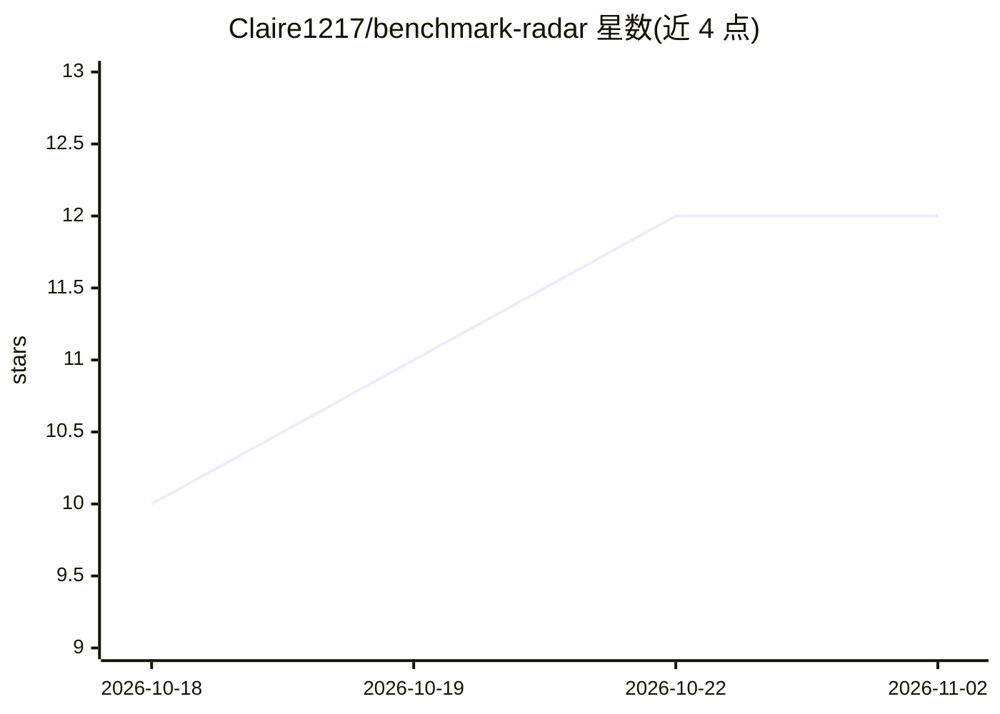

# Claire1217/benchmark-radar

⭐ 12 · HTML · 推送 2026-11-01 · [GitHub](https://github.com/Claire1217/benchmark-radar) · [官网](https://benchmark-radar.com) · 组织维护

**每日更新的 AI 基准追踪与可检索基准库（3,715 条）**

为 benchmark-radar.com 提供数据支撑的追踪仓库：每日从 arXiv、GitHub、Hugging Face、OpenReview 发现新发布的公开评测基准，去重后经语义审阅入库，记录链接到原始论文、代码与数据集。提供按注意力信号排名的 Radar、按被引使用排序的 Library、月度趋势三类视图，覆盖推理、代理、多模态、安全等十余个能力域共 3,715 条记录。附带 Agent CLI 以 JSON 输出查询结果。注意：尚未选择开源许可，公开可见不等于授予复用权；明确声明自己是发现索引而非质量背书或排行榜。

## 筛选速览

| 维度 | 判定 | 备注 |
|---|---|---|
| AI 角色 | `ai-knowledge` | 知识聚合/清单类 |
| 许可风险 | `none` | — |
| 部署形态 | `None` |  |
| 模型依赖 | — | README 未给出锁定关系 |
| 硬件要求 | — | 无带数字的原话,不猜 |
| 安装摩擦 | `low` | 无编译、无系统依赖或容器化 |
| 成熟度 | — | 结构信号不足 |

## 能力要点

- 每日从 arXiv/GitHub/Hugging Face/OpenReview 发现并去重新基准
- 3,715 条库记录，按十余个能力域分类组织
- 生成带来源链接的 Awesome AI Benchmarks 目录
- Agent CLI 返回 JSON：search/show/daily/hot 等命令

## 适用场景

- 我要找某个领域（如代理安全、长上下文）可用的评测基准
- 跟踪本月新发布的 AI 基准及其受关注情况
- 让 Agent 以 JSON 查询某基准的使用证据

## 场景标签

`模型评测` `精选清单` · 领域:评测与运维

## 证据(README 行号)

> L3:  Benchmark Radar is the official daily-updated AI benchmark tracker and searchable benchmark library. This GitHub re
> L49: Daily release discovery checks arXiv, GitHub, Hugging Face, and OpenReview, then deduplicates candidates before sem

## 星数曲线

2026-10-18 10 → 2026-11-02 12（+2）

---
*卡片 v1 · prompt 1.4 · 生成 2026-11-01 · 置信度 high · 依据 README sha `407dc723d70f` · [字段定义](../../DATASET.md)*
