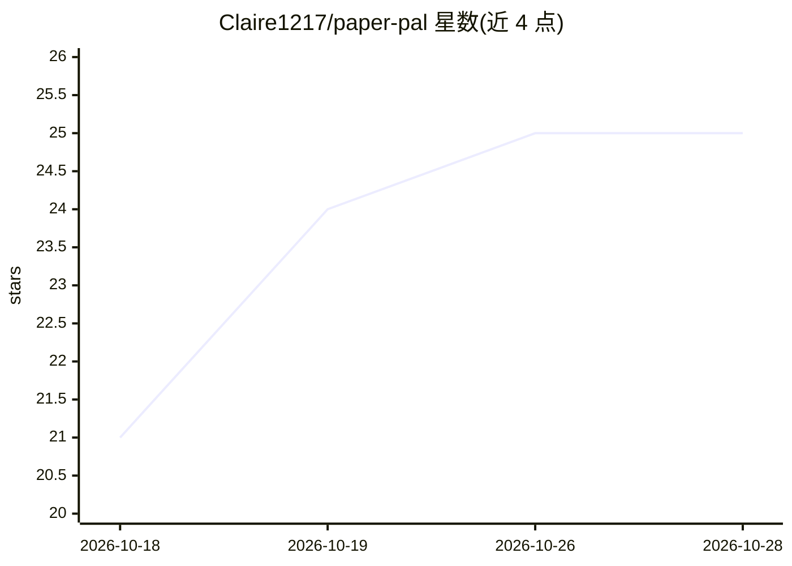

# Claire1217/paper-pal

⭐ 25 · JavaScript · MIT · 推送 2026-10-21 · [GitHub](https://github.com/Claire1217/paper-pal) · 个人维护 · 中文 README

**本地 LaTeX 论文 AI 改写审阅工具：批注→词级 diff→接受才写入**

本地运行的 Web 应用，把 LaTeX 项目在浏览器中以正文形式展示（渲染数学、引用、交叉引用）。用户选中段落写批注，所选 AI 后端返回改写建议，以红绿词级 diff 呈现，接受或拒绝前不改动 .tex 文件。支持 Claude Code、Codex CLI、OpenAI/Anthropic/OpenRouter/DeepSeek/Ollama 及任意 OpenAI 兼容端点，可按批注切换后端。附整稿审阅、项目问答、已读段落确认与 latexmk PDF 重编译。需 Node.js 20+，macOS/Linux，Windows 见 FAQ；0.1 首发版本，除 Claude Code 路径外其他后端尚未在真实服务上运行过。

## 筛选速览

| 维度 | 判定 | 备注 |
|---|---|---|
| AI 角色 | `ai-native` | 本体是模型或模型工具 |
| 许可风险 | `permissive` | MIT |
| 部署形态 | `library` | 以包/库形式分发 |
| 模型依赖 | local-ok | 支持本地模型 |
| 硬件要求 | — | 无带数字的原话,不猜 |
| 安装摩擦 | `low` | 无编译、无系统依赖或容器化 |
| 成熟度 | `idea` | |

## 能力要点

- 批注映射到 .tex 源码精确字符区间，词级 diff 逐条接受/拒绝
- 8 种后端可选：Claude Code/Codex CLI/OpenAI/Anthropic/OpenRouter/DeepSeek/Ollama/自定义 OpenAI 兼容端点
- 整稿审阅（review file）与项目问答，问答本身不改文件
- 已读段落置灰/确认与大纲进度追踪，latexmk 自动重编译 PDF

## 适用场景

- 写论文时对选定段落提修改意见并逐条审阅 AI 改写
- 全文 referee 式审阅并筛选保留问题为批注
- 本地（含 Ollama）环境下改写论文、不让文本离开本机

## 场景标签

`AI 写作` `科研工具` `文档问答` · 领域:内容生成

## 证据(README 行号)

> L5: A local web app for writing papers. Comment on a passage, get a proposed rewrite as a word-level diff,
> L97: Use a command-line agent you are already signed in to (it comes with your Claude or ChatGPT plan, no key needed), o

## 星数曲线

2026-10-18 21 → 2026-10-28 25（+4）

---
*卡片 v1 · prompt 1.4 · 生成 2026-10-27 · 置信度 high · 依据 README sha `f87c65163ce3` · [字段定义](../../DATASET.md)*
