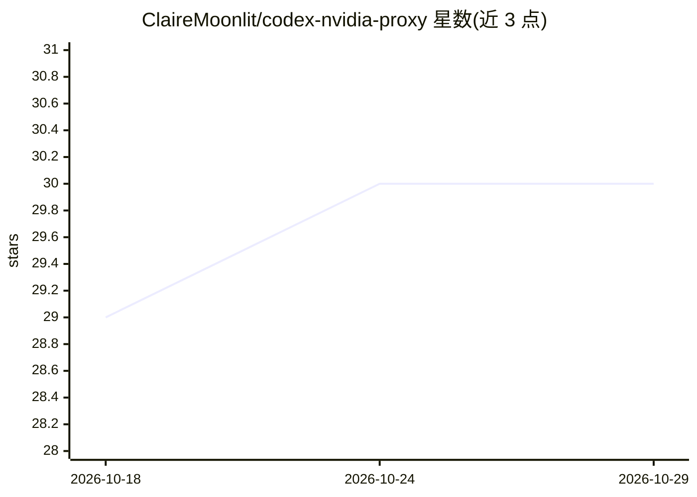

# ClaireMoonlit/codex-nvidia-proxy

⭐ 30 · JavaScript · MIT · 推送 2026-10-24 · [GitHub](https://github.com/ClaireMoonlit/codex-nvidia-proxy) · 个人维护 · 中文 README

**本地代理：让 Codex 使用 NVIDIA NIM 免费模型**

单文件零依赖的 Node.js 本地代理（监听 127.0.0.1:15721），在 Codex 的 Responses API 与 NVIDIA NIM 的 Chat Completions 协议间做全字段转换，支持流式/非流式、工具调用往返、托管多轮 Web 搜索与思考过程双通道输出。启动时自动接管并改写 ~/.codex/config.toml，从 NIM 拉取可用对话模型写入 Codex 模型目录，Ctrl+C 退出时还原配置，硬杀后可用 --restore 恢复。面向已安装 Codex CLI 或桌面版的开发者，需要免费 NVIDIA NIM API Key。限制：Chat Completions 无会话状态，多轮搜索时每轮重发完整上下文；固定占用 15721 端口。

## 筛选速览

| 维度 | 判定 | 备注 |
|---|---|---|
| AI 角色 | `ai-ecosystem` | LLM/agent 周边工具 |
| 许可风险 | `permissive` | MIT |
| 部署形态 | `library` | 以包/库形式分发 |
| 模型依赖 | — | README 未给出锁定关系 |
| 硬件要求 | — | 无带数字的原话,不猜 |
| 安装摩擦 | `low` | 无编译、无系统依赖或容器化 |
| 成熟度 | — | 结构信号不足 |

## 能力要点

- Responses ↔ Chat Completions 协议全字段转换，流式与非流式均支持
- Codex 三种工具（function/namespace 分组/apply_patch）的完整往返
- 启动自动接管 config.toml 并同步模型目录，退出自动还原，--restore 可救回硬杀残留
- 托管 Web 搜索最多 6 轮多轮流式回传；429/503 自动重试

## 适用场景

- 用 NVIDIA NIM 免费额度驱动 Codex 做编码任务
- 在 Codex 中直接选用 DeepSeek/Kimi/GLM/Nemotron 等 NIM 模型
- 长会话下依赖自动写入的窗口阈值让 Codex 自动压缩上下文

## 场景标签

`模型网关` · 领域:Agent 开发

## 证据(README 行号)

> L3: **用 NVIDIA NIM 的免费模型跑 Codex —— 一个本地的 Responses ↔ Chat Completions 协议转换桥。**
> L58: - **协议透明转换** — Codex Responses API 与 NVIDIA Chat Completions 之间的全字段映射，流式（SSE）与非流式都支持，思考过程和正文分离显示。
> L84: - 单文件 `responses_proxy.cjs`，零外部依赖，纯 Node.js 内置模块。

## 星数曲线

2026-10-18 29 → 2026-10-29 30（+1）

---
*卡片 v1 · prompt 1.4 · 生成 2026-10-26 · 置信度 mid · 依据 README sha `fcc7f34cfbdf` · [字段定义](../../DATASET.md)*
