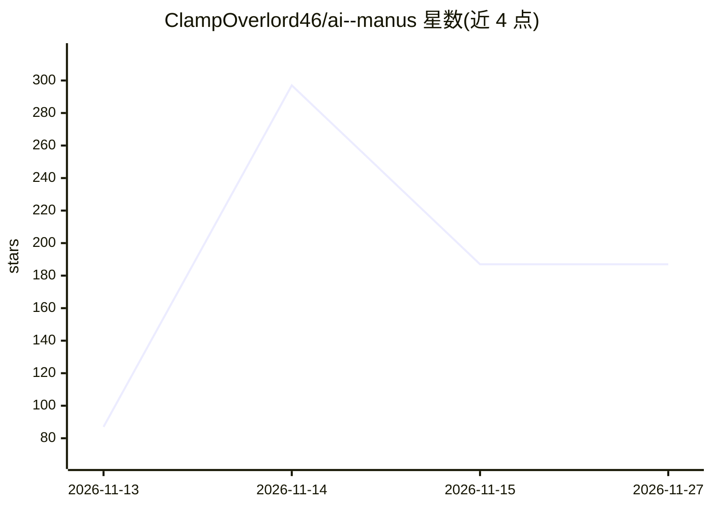

# ClampOverlord46/ai--manus

⭐ 187 · Apache-2.0 · 推送 2026-11-15 · [GitHub](https://github.com/ClampOverlord46/ai--manus) · 个人维护

**面向日常任务的自主 AI Agent：自动执行代码与浏览器操作**

README 宣称的自主 AI Agent 应用：代替用户编写并执行脚本、控制浏览器导航网页与填写表单、执行多步骤任务，定位为家庭、学习与轻量办公场景的个人助手，非企业平台。给出 CPU/内存/存储等兼容性配置表，并以“下载码 PROMO2026”形式提供下载入口；README 未给出具体安装命令、技术架构、所依赖的模型或 API 接入方式，功能描述均为营销式陈述，可验证的实现细节缺失。

## 筛选速览

| 维度 | 判定 | 备注 |
|---|---|---|
| AI 角色 | `ai-native` | 本体是模型或模型工具 |
| 许可风险 | `permissive` | Apache-2.0 |
| 部署形态 | `None` |  |
| 模型依赖 | — | README 未给出锁定关系 |
| 硬件要求 | — | 无带数字的原话,不猜 |
| 安装摩擦 | `low` | 无编译、无系统依赖或容器化 |
| 成熟度 | — | 结构信号不足 |

## 能力要点

- 宣称支持自主代码执行与浏览器控制
- 面向家庭、学习与轻量办公的多步骤任务
- README 提供硬件兼容性配置表（最低 4GB RAM/双核 CPU）

## 适用场景

- 让学生收集资料、运行小脚本并整理笔记
- 代替人工在多个网页间收集信息并生成摘要
- 把脚本任务与浏览器操作串联完成日常工作

## 场景标签

`AI 助手` `浏览器自动化` · 领域:效率与自动化

## 证据(README 行号)

> L18: Manus is an autonomous AI agent designed to run code and control a browser on your behalf. Instead of acting like a
> L10: - **Autonomous Code Execution:** Manus AI agent runs code on its own to complete tasks, so you can focus on decisio

## 星数曲线

2026-11-13 87 → 2026-11-27 187（+100）

---
*卡片 v1 · prompt 1.4 · 生成 2026-11-17 · 置信度 low · 依据 README sha `0f78ee3a5dd2` · [字段定义](../../DATASET.md)*
