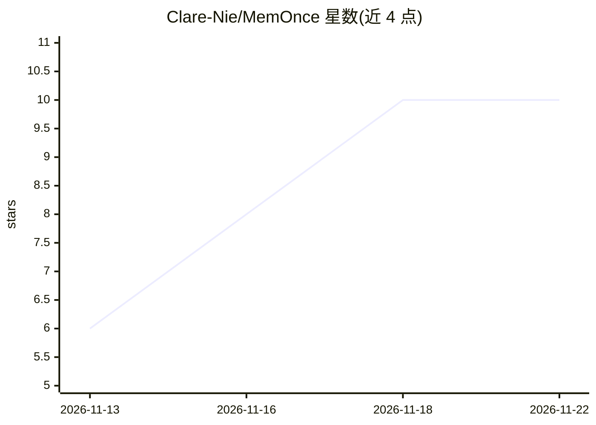

# Clare-Nie/MemOnce

⭐ 10 · Python · 推送 2026-11-17 · [GitHub](https://github.com/Clare-Nie/MemOnce) · [官网](https://clare-nie.github.io/MemOnce/) · 个人维护

**面向研究者的长上下文记忆架构：单次检索的紧凑全局记忆**

论文官方实现，提出一种用于长程持续语言建模的基础架构：仅缓存末层隐状态的 1/r 子集作为紧凑全局记忆，并通过 memory sparse attention 每次输入仅检索一次，在深度与时间上实现 L×r 压缩。仓库提供从零预训练（158M–945M）、基于冻结 Qwen3.5-2B/4B 骨干的 LoRA 后训练适配，以及长上下文基准评测脚本（membench、locomo、longmemeval 等），推理时支持将记忆库卸载至 CPU/SSD。以 pip 安装依赖运行。

## 筛选速览

| 维度 | 判定 | 备注 |
|---|---|---|
| AI 角色 | `ai-native` | 本体是模型或模型工具 |
| 许可风险 | `none` | — |
| 部署形态 | `library` | 以包/库形式分发 |
| 模型依赖 | — | README 未给出锁定关系 |
| 硬件要求 | — | 无带数字的原话,不猜 |
| 安装摩擦 | `low` | 无编译、无系统依赖或容器化 |
| 成熟度 | — | 结构信号不足 |

## 能力要点

- 缓存并单次检索全局记忆，保持线性时间复杂度与常数活跃 GPU 显存
- 预训练缩放脚本覆盖 158M–945M 规模，支持压缩比 r=1–8
- 基于冻结 Qwen3.5-4B 骨干的 LoRA 后训练与 KV 读出解码
- 评测脚本支持 membench/locomo/longmemeval 等 6 个长上下文基准

## 适用场景

- 复现论文中的长上下文记忆基准实验
- 对自有 JSONL 对话数据做长上下文后训练适配
- 在超长序列场景下运行低显存占用的记忆推理

## 场景标签

`模型评测` `微调` `模型训练` · 领域:评测与运维

## 证据(README 行号)

> L11: **MemOnce** is a foundation architecture designed for long-horizon continual language modeling.
> L23: - 🧠 **Scalable Architecture:** Caches and retrieves memory **only once**, simultaneously achieving **accurate recal
> L159:  🔥 Pre-training from Scratch (158M – 945M)

## 星数曲线

2026-11-13 6 → 2026-11-22 10（+4）

---
*卡片 v1 · prompt 1.4 · 生成 2026-11-20 · 置信度 high · 依据 README sha `911a0fc599b2` · [字段定义](../../DATASET.md)*
