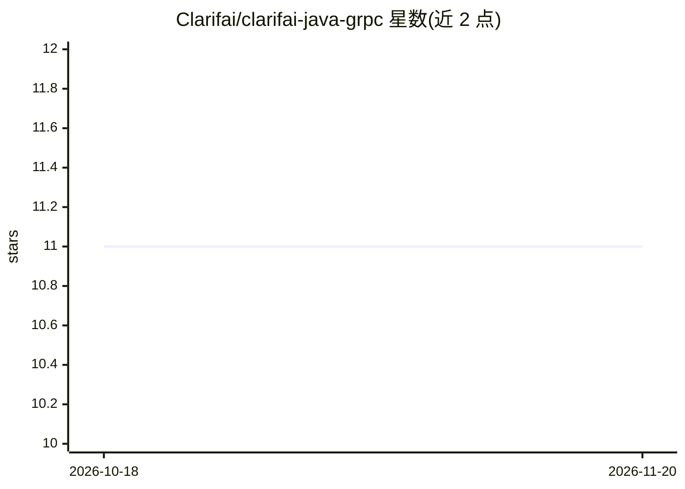

# Clarifai/clarifai-java-grpc

⭐ 11 · Java · NOASSERTION · 推送 2026-07-14 · [GitHub](https://github.com/Clarifai/clarifai-java-grpc) · [官网](https://docs.clarifai.com) · 组织维护

**Clarifai 识别 API 的 Java gRPC 官方客户端**

Clarifai 官方发布的 gRPC Java 客户端库，用于接入 Clarifai 的计算机视觉与自然语言处理 API，对图像、视频、文本执行识别等调用。通过 Maven Central 发布，支持 Gradle 与 Maven 两种引入方式；版本号前两位跟随后端 API 版本，第三位用于库自身的独立修复与改进。使用时构建 Stub 对象访问全部 API 功能，默认使用加密 gRPC 通道，另提供 HTTPS+JSON 与非加密 gRPC 通道供特殊场景选用。

## 筛选速览

| 维度 | 判定 | 备注 |
|---|---|---|
| AI 角色 | `ai-ecosystem` | LLM/agent 周边工具 |
| 许可风险 | `none` | NOASSERTION |
| 部署形态 | `None` |  |
| 模型依赖 | — | README 未给出锁定关系 |
| 硬件要求 | — | 无带数字的原话,不猜 |
| 安装摩擦 | `low` | 无编译、无系统依赖或容器化 |
| 成熟度 | — | 结构信号不足 |

## 能力要点

- 官方 gRPC Java 客户端，经 Maven Central 分发，支持 Gradle 与 Maven 引入
- 版本号前两位跟随 Clarifai 后端 API 版本
- 提供加密 gRPC、HTTPS+JSON、非加密 gRPC 三种通道

## 适用场景

- 在 Java 服务中调用 Clarifai 的图像/视频/文本识别 API
- 通过 Gradle 或 Maven 将 Clarifai 客户端集成到现有工程

## 场景标签

 · 领域:AI 平台客户端 SDK

## 证据(README 行号)

> L5: This is the official Clarifai gRPC Java client for interacting with our powerful recognition
> L7: Clarifai provides a platform for data scientists, developers, researchers and enterprises to master the entire
> L47: Construct the *Stub* object using which you'll access all the Clarifai API functionality:

## 星数曲线

2026-10-18 11 → 2026-11-20 11（+0）

---
*卡片 v1 · prompt 1.4 · 生成 2026-11-19 · 置信度 high · 依据 README sha `d0967f2e5e4d` · [字段定义](../../DATASET.md)*
