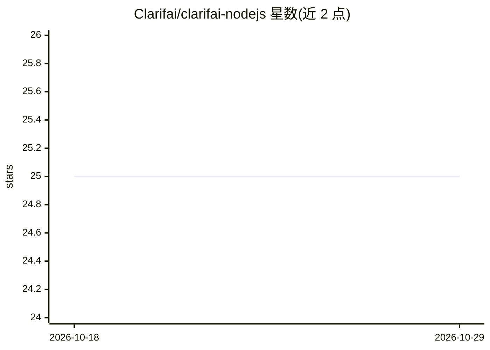

# Clarifai/clarifai-nodejs

⭐ 25 · TypeScript · NOASSERTION · 推送 2026-05-13 · [GitHub](https://github.com/Clarifai/clarifai-nodejs) · [官网](https://www.npmjs.com/package/clarifai-nodejs) · 组织维护

**Clarifai AI 平台的官方 Node.js SDK**

Clarifai 官方维护的 Node.js 客户端库，供开发者以代码调用 Clarifai 云端 AI 平台：覆盖计算机视觉（分类、检测、分割）与自然语言（分类、摘要、生成、问答）能力。通过 Personal Access Token 鉴权，支持调用平台上的模型、Workflows（如情感分析工作流）以及管理账户下的 apps 资源。README 说明当前处于 developer preview 阶段，Next.js App Directory 场景需在配置中加入 clarifai-nodejs-grpc 依赖。

## 筛选速览

| 维度 | 判定 | 备注 |
|---|---|---|
| AI 角色 | `ai-ecosystem` | LLM/agent 周边工具 |
| 许可风险 | `none` | NOASSERTION |
| 部署形态 | `library` | 以包/库形式分发 |
| 模型依赖 | — | README 未给出锁定关系 |
| 硬件要求 | — | 无带数字的原话,不猜 |
| 安装摩擦 | `low` | 无编译、无系统依赖或容器化 |
| 成熟度 | `idea` | |

## 能力要点

- 调用 Clarifai 平台模型执行识别、检测、分割与文本生成等任务
- 支持调用在 clarifai.com 上构建的自定义 Workflow
- PAT 鉴权与账户下 apps 资源的列举管理
- 提供 Next.js Server Components 使用配置说明

## 适用场景

- 在 Node.js 应用中接入 Clarifai 的图像分类与检测模型
- 通过 SDK 调用平台上自建的工作流（如图像情感分析）
- 管理 Clarifai 账户下的应用与资源

## 场景标签

 · 领域:AI 平台 SDK/开发者工具

## 证据(README 行号)

> L13: This is the official Node.js client for interacting with our powerful API. The Clarifai Node.js SDK offers a compre
> L22: npm install clarifai-nodejs

## 星数曲线

2026-10-18 25 → 2026-10-29 25（+0）

---
*卡片 v1 · prompt 1.4 · 生成 2026-10-27 · 置信度 high · 依据 README sha `4280b00da188` · [字段定义](../../DATASET.md)*
