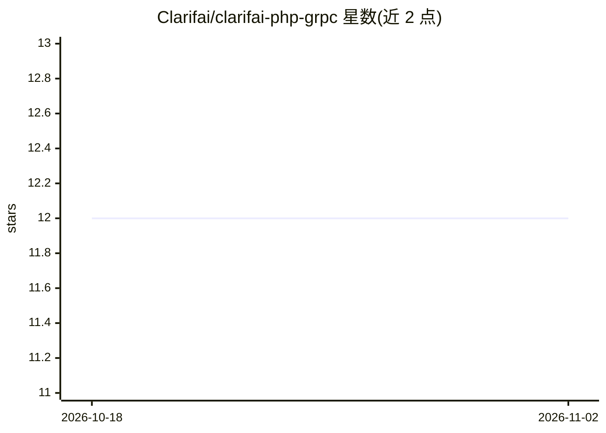

# Clarifai/clarifai-php-grpc

⭐ 12 · PHP · NOASSERTION · 推送 2026-07-14 · [GitHub](https://github.com/Clarifai/clarifai-php-grpc) · 组织维护

**Clarifai 识别 API 的官方 PHP gRPC 客户端**

Clarifai 官方发布的 PHP gRPC 客户端库，供 PHP 开发者通过 gRPC 协议调用 Clarifai 平台的识别 API，覆盖图像、视频与文本的计算机视觉与自然语言处理能力。使用方式：composer 安装后构造 ClarifaiClient，在 metadata 中设置 API Key 或 Personal Access Token，即可发起预测（如预测图像中的概念）。版本号不遵循语义化版本：前两位跟随后端 API 版本，第三位用于库自身的独立发布与修复。

## 筛选速览

| 维度 | 判定 | 备注 |
|---|---|---|
| AI 角色 | `ai-ecosystem` | LLM/agent 周边工具 |
| 许可风险 | `none` | NOASSERTION |
| 部署形态 | `None` |  |
| 模型依赖 | — | README 未给出锁定关系 |
| 硬件要求 | — | 无带数字的原话,不猜 |
| 安装摩擦 | `low` | 无编译、无系统依赖或容器化 |
| 成熟度 | — | 结构信号不足 |

## 能力要点

- 官方 PHP gRPC 客户端，访问 Clarifai 识别 API
- 支持图像、视频与文本的计算机视觉与 NLP 能力
- 通过 API Key 或 Personal Access Token 认证
- 版本号前两位跟随后端 API 版本

## 适用场景

- PHP 项目中调用 Clarifai 平台做图像/文本识别
- 在数据科学或企业应用中集成 Clarifai 的 AI 生命周期功能
- 通过 gRPC 协议与 Clarifai API 交互

## 场景标签

 · 领域:AI 平台客户端/开发者工具

## 证据(README 行号)

> L5: This is the official Clarifai gRPC PHP client for interacting with our powerful recognition
> L40: $client = ClarifaiClient::grpc();

## 星数曲线

2026-10-18 12 → 2026-11-02 12（+0）

---
*卡片 v1 · prompt 1.4 · 生成 2026-11-01 · 置信度 high · 依据 README sha `0d3c2136c860` · [字段定义](../../DATASET.md)*
