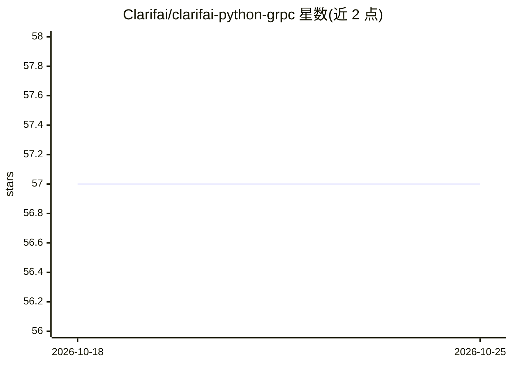

# Clarifai/clarifai-python-grpc

⭐ 57 · Python · NOASSERTION · 推送 2026-07-14 · [GitHub](https://github.com/Clarifai/clarifai-python-grpc) · [官网](https://docs.clarifai.com) · 组织维护

**Clarifai 识别 API 的官方 Python gRPC 客户端库**

Clarifai 官方维护的 Python gRPC API 客户端，通过 pip 安装 clarifai-grpc 包，构造 V2Stub 访问 Clarifai 平台的全部 API 功能，覆盖图像、视频、文本的计算机视觉与自然语言处理。版本号前两位跟随后端 API 版本，第三位用于库自身的独立发布。支持加密 gRPC、HTTPS+JSON 与非加密 gRPC 三种通道。面向数据科学家、开发者、研究人员与企业用户，需注册 Clarifai 账号使用。

## 筛选速览

| 维度 | 判定 | 备注 |
|---|---|---|
| AI 角色 | `ai-ecosystem` | LLM/agent 周边工具 |
| 许可风险 | `none` | NOASSERTION |
| 部署形态 | `library` | 以包/库形式分发 |
| 模型依赖 | — | README 未给出锁定关系 |
| 硬件要求 | — | 无带数字的原话,不猜 |
| 安装摩擦 | `low` | 无编译、无系统依赖或容器化 |
| 成熟度 | — | 结构信号不足 |

## 能力要点

- 官方 gRPC 客户端，V2Stub 访问全部 Clarifai API 功能
- 支持加密 gRPC / HTTPS+JSON / 非加密 gRPC 三种通道
- 版本号前两位跟随 Clarifai 后端 API 版本

## 适用场景

- 在 Python 代码中调用 Clarifai 的图像概念预测等识别 API
- 将 Clarifai 的视觉与 NLP 能力接入自己的应用
- 以 gRPC 通道访问 Clarifai 平台管理数据与模型

## 场景标签

 · 领域:AI 平台 API 客户端

## 证据(README 行号)

> L3: # Clarifai Python gRPC Client
> L5: This is the official Clarifai gRPC Python client for interacting with our powerful recognition
> L33: Construct the `V2Stub` object using which you'll access all the Clarifai API functionality:

## 星数曲线

2026-10-18 57 → 2026-10-25 57（+0）

---
*卡片 v1 · prompt 1.4 · 生成 2026-10-24 · 置信度 high · 依据 README sha `9ec0a5f67c41` · [字段定义](../../DATASET.md)*
