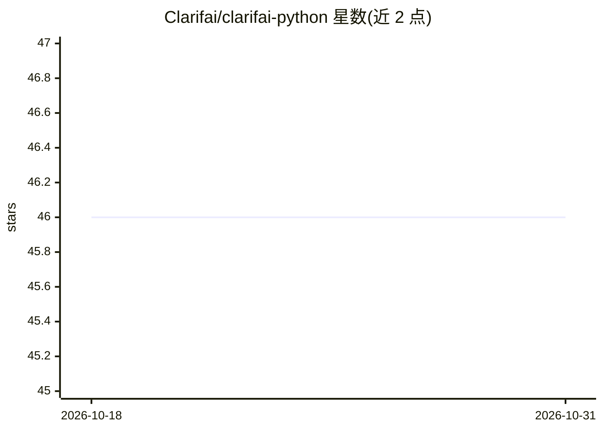

# Clarifai/clarifai-python

⭐ 46 · Python · NOASSERTION · 推送 2026-06-25 · [GitHub](https://github.com/Clarifai/clarifai-python) · [官网](https://github.com/Clarifai/clarifai-python) · 组织维护

**Clarifai AI 平台的官方 Python SDK，接入视觉与语言模型**

Clarifai 官方 Python 客户端，通过 PAT 鉴权调用 Clarifai 平台 API，覆盖模型预测与训练、评估与导出（可打包为 Triton 部署的 model.tar）、数据集与输入管理、YAML 配置的 Workflow 构建与导出、基于向量检索的图像/文本 Smart Search，以及 4 行代码搭建的 RAG 管道（默认 mistral-7B-Instruct）。另提供 Compute Orchestration 能力，管理跨硬件提供商的计算集群、Nodepool 与部署，并配套 CLI。面向在应用中集成 Clarifai 能力的开发者，依赖 Clarifai 账号与服务。

## 筛选速览

| 维度 | 判定 | 备注 |
|---|---|---|
| AI 角色 | `ai-ecosystem` | LLM/agent 周边工具 |
| 许可风险 | `none` | NOASSERTION |
| 部署形态 | `library` | 以包/库形式分发 |
| 模型依赖 | — | README 未给出锁定关系 |
| 硬件要求 | — | 无带数字的原话,不猜 |
| 安装摩擦 | `low` | 无编译、无系统依赖或容器化 |
| 成熟度 | — | 结构信号不足 |

## 能力要点

- 模型预测、训练、评估与导出（Triton 可部署的 model.tar）
- YAML 配置创建/导出 Workflow 推理管道
- 基于向量检索的图像与文本 Smart Search 及过滤/分页
- RAG.setup 四行代码搭建 RAG 管道，默认 mistral-7B-Instruct
- Compute Orchestration：集群/Nodepool/部署管理，支持跨硬件提供商与自动扩缩

## 适用场景

- 在 Python 应用中调用 Clarifai 的图像分类、检测与文本生成等模型
- 管理训练数据集并训练、评估、导出自定义模型
- 搭建并导出多模型组合的 Workflow 推理管道
- 用几行代码快速起一个文档问答 RAG 应用

## 场景标签

`RAG` · 领域:知识与检索

## 证据(README 行号)

> L12: This is the official Python client for interacting with our powerful API. The Clarifai Python SDK offers a comprehe
> L163: The **Model** Class allows you to perform predictions using Clarifai models. You can specify which model to use by

## 星数曲线

2026-10-18 46 → 2026-10-31 46（+0）

---
*卡片 v1 · prompt 1.4 · 生成 2026-10-25 · 置信度 high · 依据 README sha `3cb33ad970b9` · [字段定义](../../DATASET.md)*
