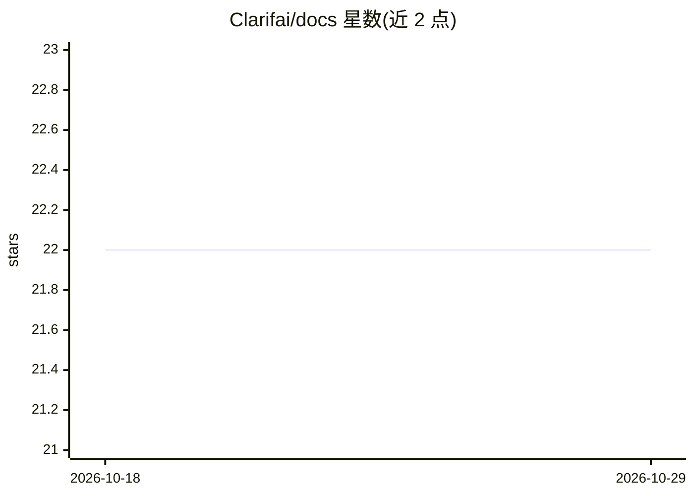

# Clarifai/docs

⭐ 22 · Python · 推送 2026-05-29 · [GitHub](https://github.com/Clarifai/docs) · 组织维护

**Clarifai 文档站仓库：基于 Docusaurus 构建的静态文档网站**

Clarifai 官方文档仓库，使用 Docusaurus 静态网站生成器构建文档站点。README 仅包含站点开发与部署说明：通过 yarn 安装依赖、yarn start 启动本地开发服务器并支持热更新、yarn build 生成静态内容到 build 目录，可用任意静态托管服务部署，或通过 yarn deploy 推送到 GitHub Pages 的 gh-pages 分支。未包含文档内容本身的结构或主题说明。

## 筛选速览

| 维度 | 判定 | 备注 |
|---|---|---|
| AI 角色 | `ai-knowledge` | 知识聚合/清单类 |
| 许可风险 | `none` | — |
| 部署形态 | `None` |  |
| 模型依赖 | — | README 未给出锁定关系 |
| 硬件要求 | — | 无带数字的原话,不猜 |
| 安装摩擦 | `low` | 无编译、无系统依赖或容器化 |
| 成熟度 | — | 结构信号不足 |

## 能力要点

- Docusaurus 静态网站生成器构建
- yarn start 本地开发服务器，改动实时生效
- yarn build 生成静态内容，支持任意静态托管
- 支持 SSH 与 GitHub Pages 两种部署命令

## 适用场景

- 本地预览和编辑 Clarifai 文档站
- 构建并部署 Clarifai 文档到静态托管服务

## 场景标签

 · 领域:AI 平台文档

## 证据(README 行号)

> L1: image
> L5: This website is built using Docusaurus, a modern static website generator.

## 星数曲线

2026-10-18 22 → 2026-10-29 22（+0）

---
*卡片 v1 · prompt 1.4 · 生成 2026-10-28 · 置信度 low · 依据 README sha `9b36b3351d83` · [字段定义](../../DATASET.md)*
