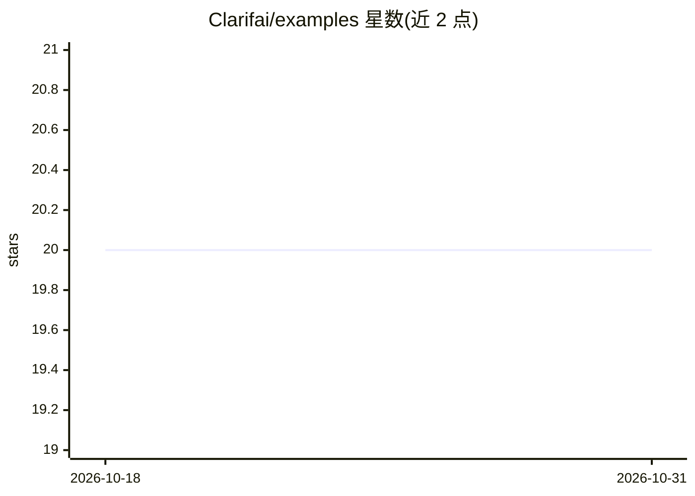

# Clarifai/examples

⭐ 20 · Jupyter Notebook · NOASSERTION · 推送 2026-05-07 · [GitHub](https://github.com/Clarifai/examples) · [官网](https://github.com/Clarifai/clarifai-python) · 组织维护

**Clarifai Python SDK 官方示例集：教你接入其 AI 平台**

Clarifai 官方维护的示例与笔记本集合，覆盖 Python SDK 与集成用法：应用/数据集/输入/模型的基础 CRUD、Compute Orchestration（ComputeCluster/Nodepool/Deployment）、模型预测与上传、MCP 工具托管、CrewAI/Google ADK agent 构建、模型训练与评估、向量搜索与 RAG，以及 LangChain/DeepEval/Unstructured.io 集成。使用需注册 Clarifai 账号并设置 PAT 环境变量；脚本本地运行但与 Clarifai 云端通信。

## 筛选速览

| 维度 | 判定 | 备注 |
|---|---|---|
| AI 角色 | `ai-knowledge` | 知识聚合/清单类 |
| 许可风险 | `none` | NOASSERTION |
| 部署形态 | `None` |  |
| 模型依赖 | — | README 未给出锁定关系 |
| 硬件要求 | — | 无带数字的原话,不猜 |
| 安装摩擦 | `low` | 无编译、无系统依赖或容器化 |
| 成熟度 | — | 结构信号不足 |

## 能力要点

- 覆盖 SDK 基础 CRUD、Compute Orchestration 与模型预测/上传
- MCP 工具上传并托管、CrewAI 与 Google ADK agent 示例
- 模型训练/评估、向量搜索与 RAG 示例笔记本
- LangChain/DeepEval/Unstructured.io 集成笔记本

## 适用场景

- 学习 Clarifai SDK 的概念与能力
- 参考 LLM/RAG/agent 应用的接入写法
- 在 Colab 中直接运行示例笔记本

## 场景标签

`教程课程` · 领域:学习与行业

## 证据(README 行号)

> L3: # Clarifai Python SDK and Integrations Examples
> L5: This is a collection of examples for the clarifai-python SDK and Integrations done with Clarifai SDK. Use these exam
> L107: Although these scripts are run on your local machine, they'll communicate with Clarifai and run in our cloud on de

## 星数曲线

2026-10-18 20 → 2026-10-31 20（+0）

---
*卡片 v1 · prompt 1.4 · 生成 2026-10-28 · 置信度 high · 依据 README sha `c584915ae27a` · [字段定义](../../DATASET.md)*
