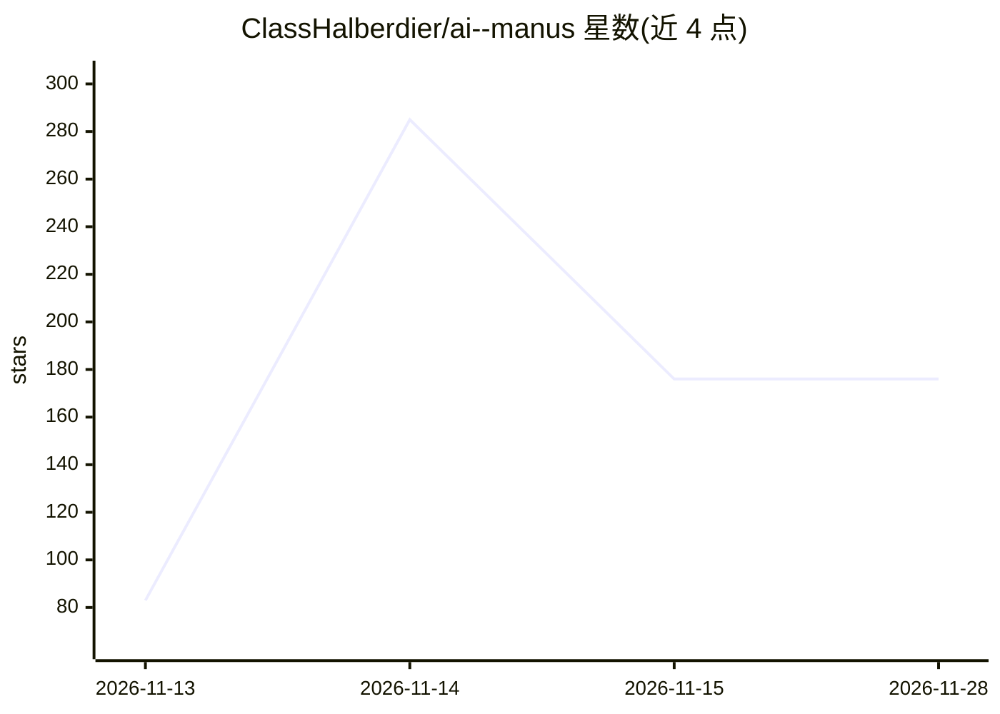

# ClassHalberdier/ai--manus

⭐ 176 · Apache-2.0 · 推送 2026-11-15 · [GitHub](https://github.com/ClassHalberdier/ai--manus) · 个人维护

**面向日常任务的自主 AI Agent：自动执行代码与浏览器操作**

Manus 是一个自主运行的 AI agent，代替用户执行代码与浏览器控制：可编写并运行脚本、打开网页、填写表单、与页面元素交互，并跨代码与浏览器组合多步任务，据称能跨会话记住工作流模式。定位为面向家庭、学习与轻量办公的个人助手，非企业平台，明确面向无需编程背景的用户。README 提供兼容性表（最低 4 GB 内存、双核 CPU）与上手步骤，但未给出具体安装命令、模型接入方式或技术架构；仓库描述提及沙箱环境运行各类工具。

## 筛选速览

| 维度 | 判定 | 备注 |
|---|---|---|
| AI 角色 | `ai-native` | 本体是模型或模型工具 |
| 许可风险 | `permissive` | Apache-2.0 |
| 部署形态 | `None` |  |
| 模型依赖 | — | README 未给出锁定关系 |
| 硬件要求 | — | 无带数字的原话,不猜 |
| 安装摩擦 | `low` | 无编译、无系统依赖或容器化 |
| 成熟度 | — | 结构信号不足 |

## 能力要点

- 自主编写并执行代码/脚本
- 浏览器控制：导航、填表、采集信息
- 代码与浏览器动作可在同一任务流中衔接
- 面向多步任务，声称可跨会话复用工作流模式

## 适用场景

- 让学生整理研究笔记并运行小脚本
- 远程工作者从多个网页收集信息
- 把重复性小任务委托给后台 agent 处理

## 场景标签

`AI 助手` `浏览器自动化` `编码 Agent` · 领域:效率与自动化

## 证据(README 行号)

> L10: - **Autonomous Code Execution:** Manus AI agent runs code on its own to complete tasks, so you can focus on decisio
> L18: Manus is an autonomous AI agent designed to run code and control a browser on your behalf. Instead of acting like a
> L22: Manus is not a heavy studio suite or a complex enterprise platform. It is a focused helper built for home, study, a

## 星数曲线

2026-11-13 83 → 2026-11-28 176（+93）

---
*卡片 v1 · prompt 1.4 · 生成 2026-11-17 · 置信度 high · 依据 README sha `0f78ee3a5dd2` · [字段定义](../../DATASET.md)*
