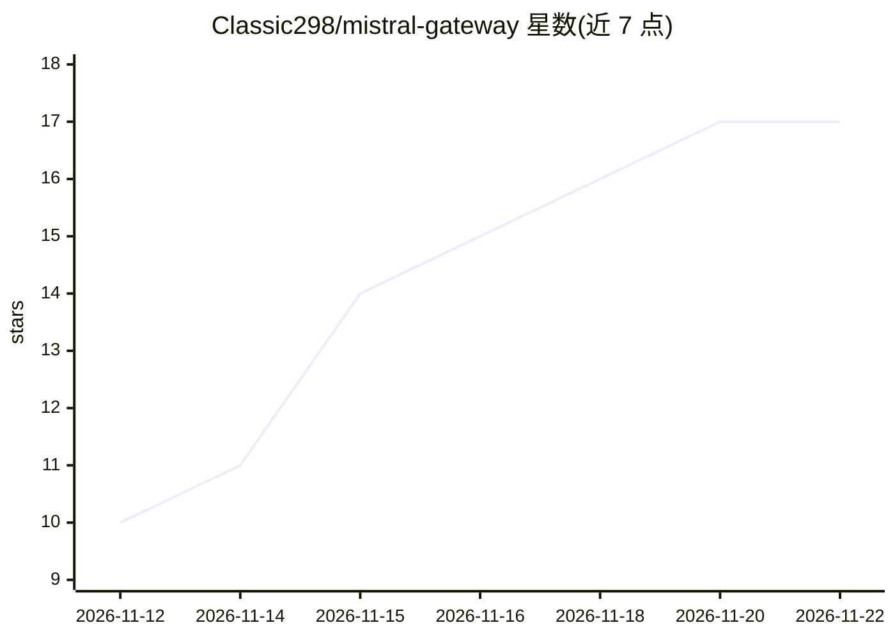

# Classic298/mistral-gateway

⭐ 17 · Python · NOASSERTION · 推送 2026-11-15 · [GitHub](https://github.com/Classic298/mistral-gateway) · 个人维护

**本地代理：让 OpenAI 兼容客户端使用 Mistral Vibe 订阅内的模型**

单文件 Python 本地代理（仅依赖标准库），读取 Mistral Vibe 官方 CLI 登录生成的订阅密钥（或手动复制的 Vibe API Key），把请求转发到 Mistral 公共 API，并以 OpenAI 兼容格式返回响应，供 Open WebUI、编辑器、脚本等客户端使用。提供 /v1/chat/completions、/v1/responses、/v1/models 等端点，转换 Mistral 与 OpenAI 格式差异（reasoning、tool calls、token 计数），支持 Studio 按量付费密钥作为限流回退，记录用量与配额。需 Python 3.10+ 与含编码功能的 Vibe 订阅（Pro/Team/Enterprise）。项目声明非官方、与 Mistral AI 无关。

## 筛选速览

| 维度 | 判定 | 备注 |
|---|---|---|
| AI 角色 | `ai-ecosystem` | LLM/agent 周边工具 |
| 许可风险 | `none` | NOASSERTION |
| 部署形态 | `self-host` | docker 或自建部署 |
| 模型依赖 | — | README 未给出锁定关系 |
| 硬件要求 | — | 无带数字的原话,不猜 |
| 安装摩擦 | `low` | 无编译、无系统依赖或容器化 |
| 成熟度 | — | 结构信号不足 |

## 能力要点

- 单 Python 文件实现，仅依赖标准库
- 转换 Mistral 与 OpenAI 格式差异（reasoning 级别就近替换、tool calls、token 计数）
- 可选 Studio API 密钥作为 Vibe 密钥限流/额度耗尽时的回退
- /usage 与 /quota 端点记录每日 token 用量与订阅配额

## 适用场景

- 让 Open WebUI 等本地客户端调用 Mistral Vibe 订阅内的模型
- 在编辑器或脚本中以 OpenAI 兼容接口访问 Mistral 模型
- 查看订阅配额使用情况与按模型统计的 token 用量

## 场景标签

`模型网关` · 领域:Agent 开发

## 证据(README 行号)

> L3: A small local proxy that lets any OpenAI-compatible chat client (Open WebUI, editors, scripts) use the models includ
> L199: - Serves `/v1/chat/completions`, `/v1/responses` and `/v1/models` on `127.0.0.1:8788` and passes them to Mistral's

## 星数曲线

2026-11-12 10 → 2026-11-22 17（+7）

---
*卡片 v1 · prompt 1.4 · 生成 2026-11-18 · 置信度 mid · 依据 README sha `4fe00f12174b` · [字段定义](../../DATASET.md)*
