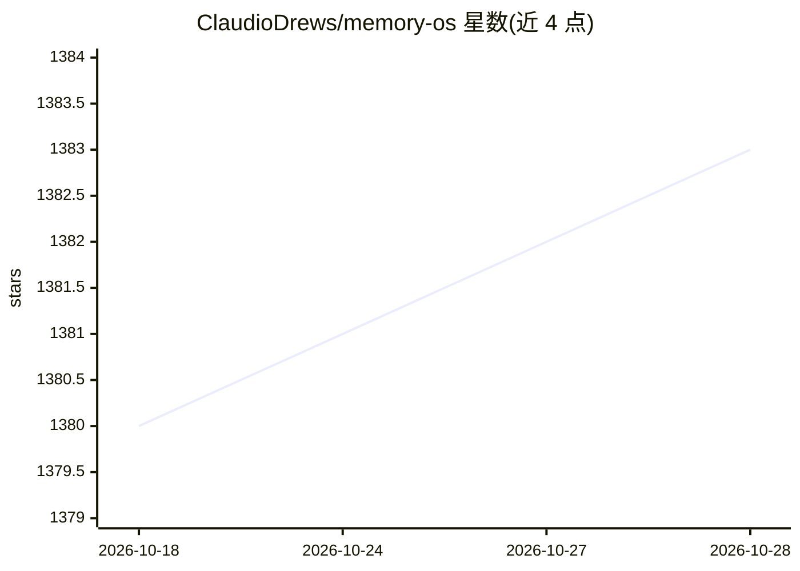

# ClaudioDrews/memory-os

⭐ 1,383 · Python · MIT · 推送 2026-09-20 · [GitHub](https://github.com/ClaudioDrews/memory-os) · 个人维护

**给 Hermes Agent 的 7 层本地持久记忆系统**

面向 Hermes Agent 用户的记忆基础设施：以 7 层架构组织记忆（工作区文件、会话 FTS5 搜索、结构化事实与信任评分、Fabric/Qdrant 多源召回、自维护 Wiki、Ground Truth 指令层），在 pre_llm_call 时按相关性阈值做上下文注入，post_llm_call 自动提取学习内容。记忆栈（Qdrant + Redis + ARQ Worker）通过 Docker 本地运行，LLM 提供方可选（OpenRouter/OpenAI/Anthropic/Ollama/本地模型）。要求 Hermes Agent + Docker + Python 3.11+，v0.2.0 提供一键安装脚本。

## 筛选速览

| 维度 | 判定 | 备注 |
|---|---|---|
| AI 角色 | `ai-ecosystem` | LLM/agent 周边工具 |
| 许可风险 | `permissive` | MIT |
| 部署形态 | `self-host` | docker 或自建部署 |
| 模型依赖 | local-ok | 支持本地模型 |
| 硬件要求 | — | 无带数字的原话,不猜 |
| 安装摩擦 | `low` | 无编译、无系统依赖或容器化 |
| 成熟度 | — | 结构信号不足 |

## 能力要点

- 7 层记忆架构：从文件到向量库的多源召回与注入
- Ground Truth 层级指示 agent 将注入记忆视为权威来源
- 结构化事实库带信任评分与反馈回路
- 本地 Docker 栈运行，LLM 提供方可选

## 适用场景

- 让 Hermes Agent 跨会话记住项目、决策与偏好
- 本地私有运行记忆栈，不依赖云记忆订阅
- 为 agent 按需注入相关历史上下文以节省 token

## 场景标签

`Agent 记忆` · 领域:Agent 开发

## 证据(README 行号)

> L41: **Requirements:** Hermes Agent + Docker (Qdrant + Redis + ARQ Worker) + Python 3.11+.
> L12: **Memory infrastructure runs entirely on your machine. Works with any LLM provider — OpenRouter, OpenAI, Anthropic,

## 星数曲线

2026-10-18 1,380 → 2026-10-28 1,383（+3）

---
*卡片 v1 · prompt 1.4 · 生成 2026-10-21 · 置信度 mid · 依据 README sha `fa8957a31bdd` · [字段定义](../../DATASET.md)*
