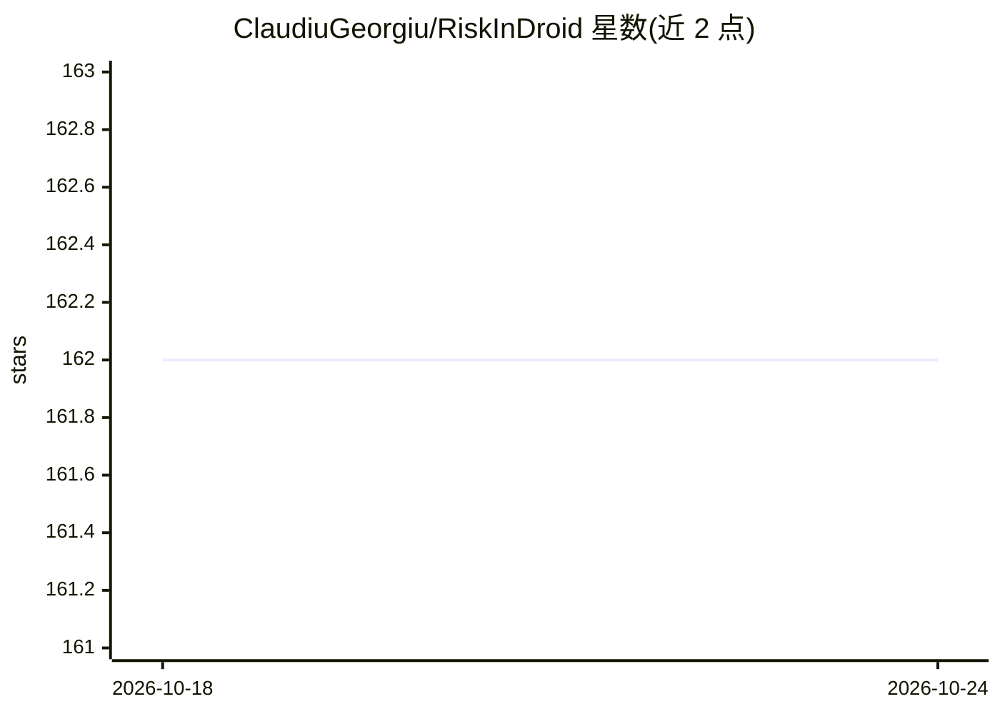

# ClaudiuGeorgiu/RiskInDroid

⭐ 162 · Python · MIT · 推送 2026-09-21 · [GitHub](https://github.com/ClaudiuGeorgiu/RiskInDroid) · 个人维护

**基于机器学习的 Android 应用权限风险量化分析工具**

用 Java 与 Python 编写的 Android 应用风险分析工具：对 APK 做逆向工程提取字节码，通过静态分析推断权限实际使用情况，构建 Declared/Exploited/Ghost/Useless 四组权限集合，再用 scikit-learn 的 SVM、MNB、GB、LR 四种分类器生成 0-100 的数值风险值。模型在超过 6K 恶意样本与 112K 应用的数据集上测试过。提供 Docker 镜像与源码两种安装方式，运行后通过 Web 界面上传 APK 计算风险；源码方式需要 Python 3.10+、Java 8+ 与 7z 解压工具。数据采集于 2016 年末，当前结果可能与原论文略有差异。

## 筛选速览

| 维度 | 判定 | 备注 |
|---|---|---|
| AI 角色 | `ai-native` | 本体是模型或模型工具 |
| 许可风险 | `permissive` | MIT |
| 部署形态 | `self-host` | docker 或自建部署 |
| 模型依赖 | — | README 未给出锁定关系 |
| 硬件要求 | — | 无带数字的原话,不猜 |
| 安装摩擦 | `low` | 无编译、无系统依赖或容器化 |
| 成熟度 | — | 结构信号不足 |

## 能力要点

- 逆向工程+静态分析提取实际使用的权限（4 组权限集合）
- 4 种 scikit-learn 分类器生成 0-100 风险值
- 提供 Web 界面上传 APK 并计算风险
- 附带预训练模型，可从源数据重新训练

## 适用场景

- 上传 APK 评估 Android 应用的权限风险分值
- 检查应用中声明但未使用或未声明却使用的权限
- 复现论文中的风险分析实验结果

## 场景标签

 · 领域:安全/移动应用分析

## 证据(README 行号)

> L9: uses classification techniques through *scikit-learn*, a machine learning library for
> L10: Python, in order to generate a numeric risk value between 0 and 100 for a given app.
> L20: the apps to retrieve the bytecode and then infers (through static analysis) which

## 星数曲线

2026-10-18 162 → 2026-10-24 162（+0）

---
*卡片 v1 · prompt 1.4 · 生成 2026-10-22 · 置信度 high · 依据 README sha `5a24c742c57b` · [字段定义](../../DATASET.md)*
