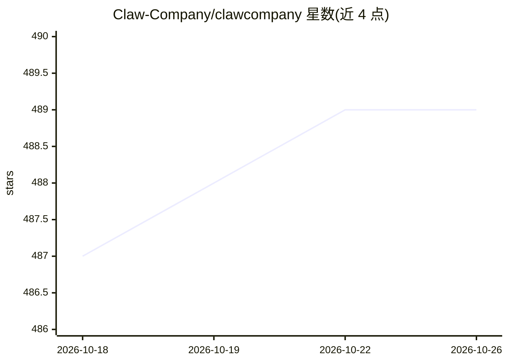

# Claw-Company/clawcompany

⭐ 489 · TypeScript · MIT · 推送 2026-04-25 · [GitHub](https://github.com/Claw-Company/clawcompany) · 组织维护

**开源 AI 公司 OS：38 个角色、6 套模板、4 层记忆的自主多智能体**

面向终端用户的多智能体应用：用户以“董事长”身份下达任务，Leader 拆解为工作流，Researcher/Analyst/Writer 等角色通过 think→act→observe 循环自主执行，产出报告（可导出 PPT/Word/PDF）。提供 38 个角色与 6 套模板（默认/YC 创业/交易台/研究实验室/软件开发/Harness Builder），9 种工具，4 层公司记忆并在每次任务注入约 400 token。支持 5 个内置模型提供商，BYOK 模式，本地运行；通过 npx 安装，要求 Node.js 20+。另有关闭源收费的 macOS 同架构项目 Sagit。

## 筛选速览

| 维度 | 判定 | 备注 |
|---|---|---|
| AI 角色 | `ai-native` | 本体是模型或模型工具 |
| 许可风险 | `permissive` | MIT |
| 部署形态 | `library` | 以包/库形式分发 |
| 模型依赖 | local-ok | 支持本地模型 |
| 硬件要求 | — | 无带数字的原话,不猜 |
| 安装摩擦 | `low` | 无编译、无系统依赖或容器化 |
| 成熟度 | — | 结构信号不足 |

## 能力要点

- 38 个 AI 角色 + 6 套可一键切换的公司模板
- 4 层公司记忆（Chairman/Company/Archive/Session），每次任务约注入 400 token
- 9 种工具与 think→act→observe 自主执行循环
- npx 一条命令启动，无需 Docker 与配置文件，支持 5 个内置提供商

## 适用场景

- 让 AI 团队自主完成研究报告并导出为文档
- 按创业/交易/研究等场景切换预设团队模板
- 长期积累公司偏好与决策记忆，反复复用

## 场景标签

`多智能体` · 领域:Agent 开发

## 证据(README 行号)

> L37: You are the Chairman. Your AI team executes autonomously.
> L40: Leader decomposes into work streams
> L43: → Writer formats the report
> L83: Agents use a **think → act → observe** loop autonomously.

## 星数曲线

2026-10-18 487 → 2026-10-26 489（+2）

---
*卡片 v1 · prompt 1.4 · 生成 2026-10-21 · 置信度 high · 依据 README sha `3d3a0d2fb661` · [字段定义](../../DATASET.md)*
