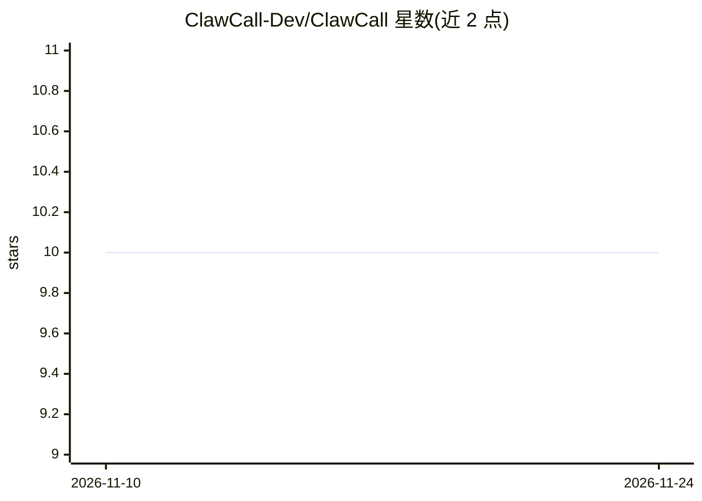

# ClawCall-Dev/ClawCall

⭐ 10 · TypeScript · MIT · 推送 2026-11-19 · [GitHub](https://github.com/ClawCall-Dev/ClawCall) · [官网](https://clawcall.dev) · 组织维护

**让 AI agent 通过 MCP 拨打真实电话的远程服务**

ClawCall 提供一个远程 MCP 服务器端点，AI 客户端添加该 URL 并经 OAuth 2.1 登录后，其 agent 可拨打美国电话号码：语音 agent 代为通话，支持 25 种语言、按键导航电话菜单、等待接听、转接用户加入通话、留言与录制，并返回通话结果与逐轮转写。定价为订阅制（每月 8.99 美元起），仅限拨打美国号码，且每账户同时只能一路外呼。仓库内含 Cursor/Grok Build 插件源码、Hermes/OpenClaw 技能安装包及遗留的本地 stdio MCP 包。

## 筛选速览

| 维度 | 判定 | 备注 |
|---|---|---|
| AI 角色 | `ai-ecosystem` | LLM/agent 周边工具 |
| 许可风险 | `permissive` | MIT |
| 部署形态 | `None` |  |
| 模型依赖 | locked-api |  |
| 硬件要求 | — | 无带数字的原话,不猜 |
| 安装摩擦 | `low` | 无编译、无系统依赖或容器化 |
| 成熟度 | — | 结构信号不足 |

## 能力要点

- 远程 MCP 端点，OAuth 2.1 登录，无需 API key 或自购号码
- 提供 14 个 MCP 工具：发起/追踪/挂断通话、获取转写与录音等
- 语音 agent 支持 25 种语言、电话菜单导航与等待接听
- 提供 Cursor/Grok Build 插件与 ClawHub/Hermes 技能安装方式

## 适用场景

- 让 agent 代打电话确认处方、预约或转接人工客服
- 在 ChatGPT/Claude 等客户端中接入电话外呼能力
- 需要通话逐轮转写作为记录的场景

## 场景标签

`语音 Agent` · 领域:对话与助手

## 证据(README 行号)

> L1: # ClawCall: phone calls for AI agents
> L3: ClawCall is a remote MCP server that lets an AI agent make real phone calls. Add one URL to ChatGPT, Claude, Cursor,

## 星数曲线

2026-11-10 10 → 2026-11-24 10（+0）

---
*卡片 v1 · prompt 1.4 · 生成 2026-11-20 · 置信度 high · 依据 README sha `6764cdc9a953` · [字段定义](../../DATASET.md)*
