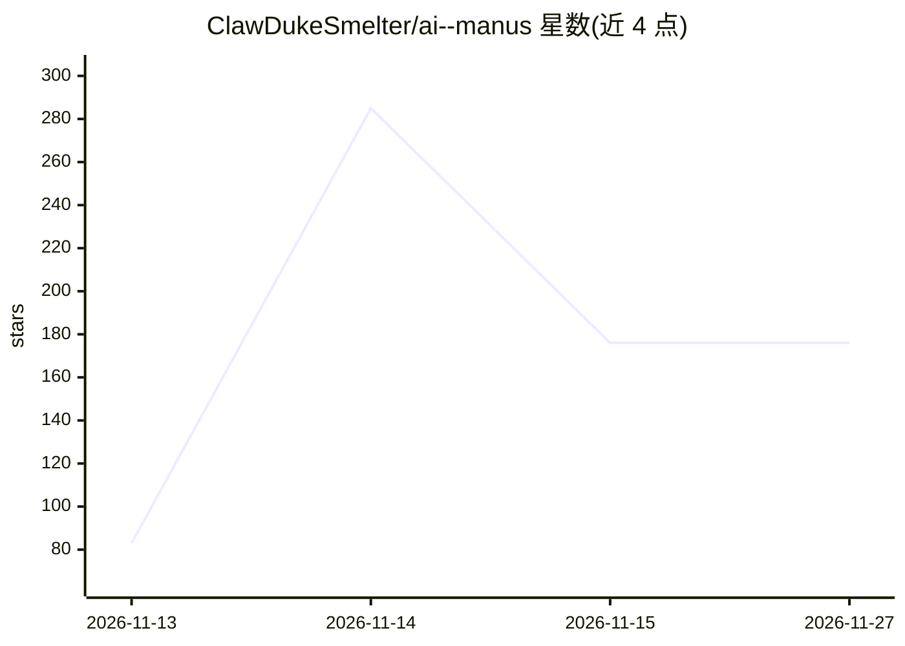

# ClawDukeSmelter/ai--manus

⭐ 176 · Apache-2.0 · 推送 2026-11-15 · [GitHub](https://github.com/ClawDukeSmelter/ai--manus) · 个人维护

**面向日常小任务的自主 AI Agent：可执行代码与控制浏览器**

README 以宣传性文案描述一个名为 Manus 的自主 AI Agent，声称可代替用户编写并执行脚本、控制浏览器完成表单填写与信息收集、执行多步骤任务，并可在后台作为个人助理运行，跨会话记忆工作流模式。定位为家庭、学习与轻度办公场景的小型助手，非企业平台。但 README 未提供任何安装命令、仓库内容说明、模型接入方式或代码结构信息，仅在开头给出 'Download Manus / PROMO2026' 字样与硬件兼容表，技术可验证性有限。

## 筛选速览

| 维度 | 判定 | 备注 |
|---|---|---|
| AI 角色 | `ai-native` | 本体是模型或模型工具 |
| 许可风险 | `permissive` | Apache-2.0 |
| 部署形态 | `None` |  |
| 模型依赖 | — | README 未给出锁定关系 |
| 硬件要求 | — | 无带数字的原话,不猜 |
| 安装摩擦 | `low` | 无编译、无系统依赖或容器化 |
| 成熟度 | — | 结构信号不足 |

## 能力要点

- 自主执行代码与脚本（宣称）
- 浏览器控制：导航网页、填写表单、抓取信息（宣称）
- 跨会话记忆工作流模式（宣称）
- 代码与浏览器动作可在同一任务流中衔接（宣称）

## 适用场景

- 让学生整理研究笔记、跑小脚本
- 远程工作者从多个网页收集数据
- 把重复性的小型日常任务委托给后台代理

## 场景标签

`AI 助手` `浏览器自动化` · 领域:效率与自动化

## 证据(README 行号)

> L18: Manus is an autonomous AI agent designed to run code and control a browser on your behalf. Instead of acting like a
> L22: Manus is not a heavy studio suite or a complex enterprise platform. It is a focused helper built for home, study, a

## 星数曲线

2026-11-13 83 → 2026-11-27 176（+93）

---
*卡片 v1 · prompt 1.4 · 生成 2026-11-17 · 置信度 low · 依据 README sha `a3d88e202bf0` · [字段定义](../../DATASET.md)*
