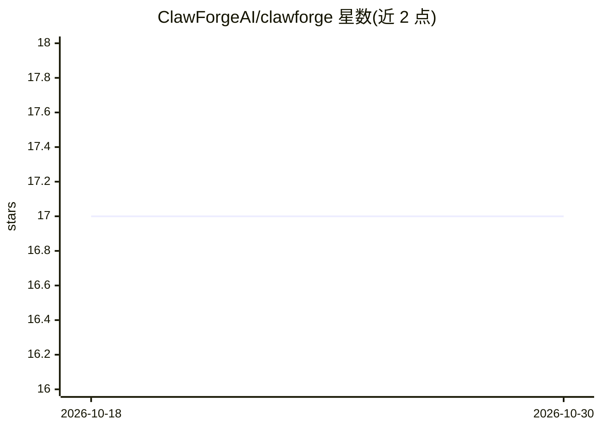

# ClawForgeAI/clawforge

⭐ 17 · TypeScript · MIT · 推送 2026-10-22 · [GitHub](https://github.com/ClawForgeAI/clawforge) · [官网](https://clawforge.co/) · 组织维护

**多运行时 AI agent 的治理控制平面与运营控制台**

面向企业多 agent 环境的开源控制平面：通过适配器（SDK 钩子、MCP 代理、运行时钩子）统一治理 Claude Code、OpenAI Agents、LangGraph、OpenClaw、Microsoft AGT 及自定义 agent。能力包括 agent 机群清单、集中式策略引擎、审批工作流、append-only 审计与证据导出、心跳绑定的 fail-secure 停机开关。自我定位为运行时之上的运营层而非检测类安全产品。Docker Compose 自托管部署，MIT 许可。

## 筛选速览

| 维度 | 判定 | 备注 |
|---|---|---|
| AI 角色 | `ai-ecosystem` | LLM/agent 周边工具 |
| 许可风险 | `permissive` | MIT |
| 部署形态 | `self-host` | docker 或自建部署 |
| 模型依赖 | — | README 未给出锁定关系 |
| 硬件要求 | — | 无带数字的原话,不猜 |
| 安装摩擦 | `low` | 无编译、无系统依赖或容器化 |
| 成熟度 | — | 结构信号不足 |

## 能力要点

- 跨运行时的 agent 机群清单与集中式策略引擎
- append-only 审计管道，可按 agent/运行时/策略决策查询并导出证据包
- 无需联网的本地 fail-secure 停机开关
- MCP 目录治理控制台与审批队列

## 适用场景

- 统一管理混合运行时的 agent 机群与权限策略
- 为 MCP 服务器接入建立白名单与审批流程
- 事后重建 agent 行为证据以满足安全与合规审查
- 紧急情况下对 agent 执行统一的停止操作

## 场景标签

 · 领域:AI agent 治理/运维基础设施

## 证据(README 行号)

> L27: ClawForge is a **control plane and operator console for AI agents at work**. It centralises policy, audit, and inci
> L43: Four layers, vendor-neutral by design. ClawForge meets each runtime where it lives — local enforcement where the ru

## 星数曲线

2026-10-18 17 → 2026-10-30 17（+0）

---
*卡片 v1 · prompt 1.4 · 生成 2026-10-30 · 置信度 high · 依据 README sha `2d9008c0af65` · [字段定义](../../DATASET.md)*
