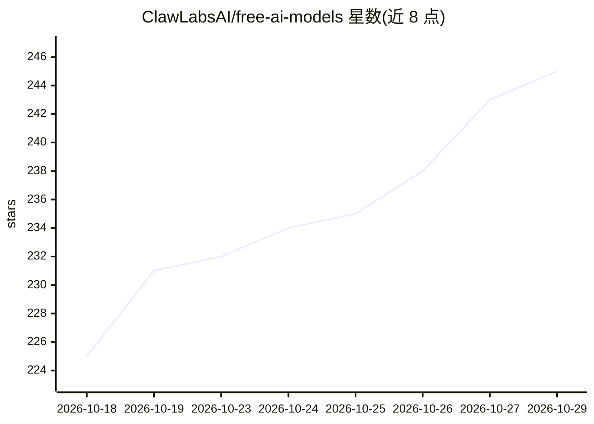

# ClawLabsAI/free-ai-models

⭐ 245 · JavaScript · MIT · 推送 2026-10-28 · [GitHub](https://github.com/ClawLabsAI/free-ai-models) · [官网](https://www.zerolimitai.com/developers?utm_source=github&utm_medium=repo_about) · 组织维护

**每日更新的免费 LLM API 模型清单，附开放质量评分与数据政策**

由 ClawLabsAI 维护的免费 AI 模型聚合清单：GitHub Actions 每日重新生成排名，评分基于 Artificial Analysis 基准指数与 LM Arena 评级（纯函数 scoring/score.js，可复算），并列出每个模型免费端点的实际服务商、是否会用你的提示词训练及保留时长。数据以 data/models.json（稳定 URL）与每日快照形式提供，模型 ID 为 OpenRouter ID，可直接用于 OpenAI SDK、LiteLLM、Cline 等工具。维护者另提供基于同一排名的托管路由 ZeroLimitAI。

## 筛选速览

| 维度 | 判定 | 备注 |
|---|---|---|
| AI 角色 | `ai-knowledge` | 知识聚合/清单类 |
| 许可风险 | `permissive` | MIT |
| 部署形态 | `None` |  |
| 模型依赖 | — | README 未给出锁定关系 |
| 硬件要求 | — | 无带数字的原话,不猜 |
| 安装摩擦 | `low` | 无编译、无系统依赖或容器化 |
| 成熟度 | — | 结构信号不足 |

## 能力要点

- 每日自动重建排名，评分方法为纯函数且每日快照可复算
- 标注每个免费端点的服务商、是否训练用户提示词与保留时长
- data/models.json 经稳定 URL 提供，兼容 OpenAI SDK / LiteLLM / Cline 等
- 附带各免费服务商的 Base URL、免费额度与是否需 Key 的对照表

## 适用场景

- 查找当前可用的免费 LLM API 并比较质量评分
- 构建工具时筛选支持函数调用且不训练用户数据的免费模型
- 通过 JSON 数据源程序化获取每日免费模型列表

## 场景标签

`精选清单` · 领域:学习与行业

## 证据(README 行号)

> L10: **A daily-updated list of every free AI model (free LLM API) available right now,
> L26: - **It is data, not just a page.** `data/models.json` is
> L27:  regenerated daily with every score and every input the score was computed

## 星数曲线

2026-10-18 225 → 2026-10-29 245（+20）

---
*卡片 v1 · prompt 1.4 · 生成 2026-10-22 · 置信度 high · 依据 README sha `b1dbb535ebfe` · [字段定义](../../DATASET.md)*
