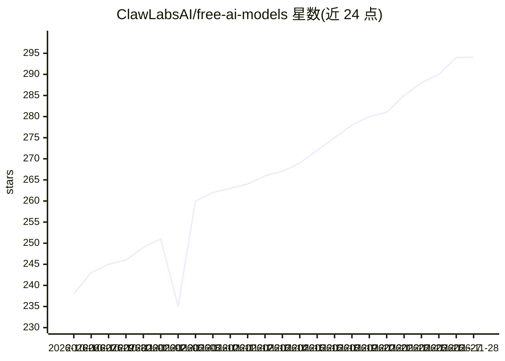

# ClawLabsAI/free-ai-models

⭐ 294 · JavaScript · MIT · 推送 2026-11-27 · [GitHub](https://github.com/ClawLabsAI/free-ai-models) · [官网](https://www.zerolimitai.com/developers?utm_source=github&utm_medium=repo_about) · 组织维护

**每日更新的免费 LLM API 清单：按质量排名并标注数据政策**

以仓库形式维护的免费模型（免费 LLM API）清单，每天由 GitHub Action 重新生成 data/models.json 并保存历史快照。评分方法为开源的 scoring/score.js，结合 Artificial Analysis 基准指数与 LM Arena 评分，含无测量模型的家族/先验折算。每条记录列出托管方是否可能用你的 prompt 训练、保留时长、上下文窗口、工具支持与实时可用状态。数据为纯 JSON，可经 curl/jq/Python/OpenAI SDK 消费；克隆仓库后可用 npm 复算排名。不提供模型本身，仅提供数据与评分。

## 筛选速览

| 维度 | 判定 | 备注 |
|---|---|---|
| AI 角色 | `ai-knowledge` | 知识聚合/清单类 |
| 许可风险 | `permissive` | MIT |
| 部署形态 | `None` |  |
| 模型依赖 | — | README 未给出锁定关系 |
| 硬件要求 | — | 无带数字的原话,不猜 |
| 安装摩擦 | `low` | 无编译、无系统依赖或容器化 |
| 成熟度 | — | 结构信号不足 |

## 能力要点

- 每日重生成的 data/models.json 及按日快照 data/history/
- 开源可复算的评分方法（基准+LM Arena 按 55/45 混合）
- 逐条标注托管方数据政策：是否用 prompt 训练、保留时长
- 免费端点实时可用状态列

## 适用场景

- 给应用挑一个不会拿 prompt 训练的免费模型
- 用 jq/脚本直接读 JSON 数据取当天最佳免费模型
- 在 OpenRouter 上按 data_collection: deny 拒绝会用数据训练的托管方
- 对评分权重有异议时改权重复算并提 PR

## 场景标签

`精选清单` · 领域:学习与行业

## 证据(README 行号)

> L10: **A daily-updated list of every free AI model (free LLM API) available right now,
> L26: - **It is data, not just a page.** `data/models.json` is

## 星数曲线

2026-10-26 238 → 2026-11-28 294（+56）

---
*卡片 v1 · prompt 1.4 · 生成 2026-11-28 · 置信度 high · 依据 README sha `1280a574de1d` · [字段定义](../../DATASET.md)*
