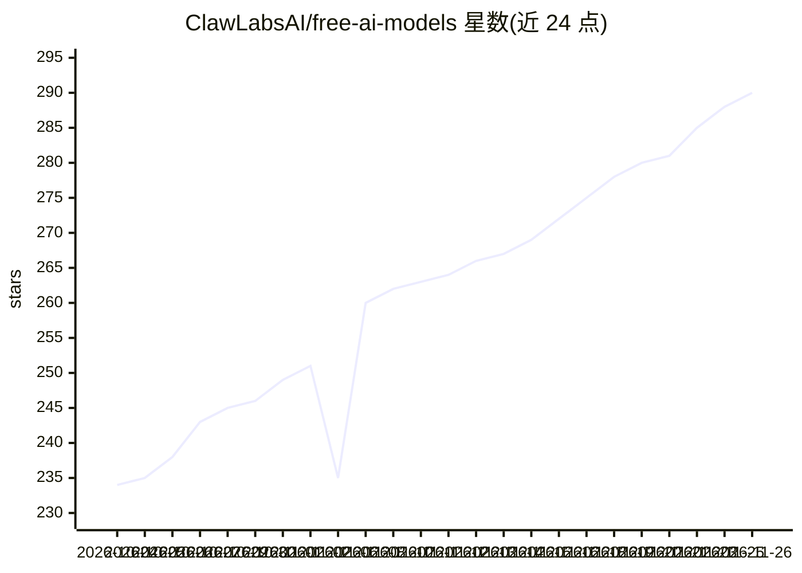

# ClawLabsAI/free-ai-models

⭐ 290 · JavaScript · MIT · 推送 2026-11-25 · [GitHub](https://github.com/ClawLabsAI/free-ai-models) · [官网](https://www.zerolimitai.com/developers?utm_source=github&utm_medium=repo_about) · 组织维护

**每日更新的免费 LLM API 排名清单，附质量评分与数据政策标注**

一份每日自动更新的免费 AI 模型（免费 LLM API）清单：通过可复算的评分脚本（scoring/score.js）结合 Artificial Analysis 基准指数与 LM Arena 评分对约 13 个免费聊天模型排序，并标注每个模型免费端点的提供方、是否可能用用户提示词做训练、保留时长、上下文/输出上限与实时可用状态。数据以 models.json 形式每日再生成并保留历史快照，可通过 curl/jq/Python 直接读取；仓库另维护各直连 provider 的 base URL 与免费额度表，并指向维护者自建的 ZeroLimitAI 路由服务。

## 筛选速览

| 维度 | 判定 | 备注 |
|---|---|---|
| AI 角色 | `ai-knowledge` | 知识聚合/清单类 |
| 许可风险 | `permissive` | MIT |
| 部署形态 | `None` |  |
| 模型依赖 | — | README 未给出锁定关系 |
| 硬件要求 | — | 无带数字的原话,不猜 |
| 安装摩擦 | `low` | 无编译、无系统依赖或容器化 |
| 成熟度 | — | 结构信号不足 |

## 能力要点

- models.json 每日再生成并保留每日快照，评分输入完整可复算
- 评分方法为一个纯函数脚本，用户可改权重后重跑并提交 PR
- 每行标注服务方是否用提示词训练及保留时长
- id 为 OpenRouter id，可直接用于 OpenAI SDK、LiteLLM、Cline 等工具

## 适用场景

- 想找免费 LLM API 时按质量分数挑选模型
- 发送客户数据前先确认该免费端点是否会用提示词训练
- 在脚本或编码工具中以 JSON 数据形式程序化获取今日最优免费模型

## 场景标签

`精选清单` · 领域:学习与行业

## 证据(README 行号)

> L10: **A daily-updated list of every free AI model (free LLM API) available right now,
> L26: - **It is data, not just a page.** `data/models.json` is
> L177: The whole method is `scoring/score.js` (pure: no network,

## 星数曲线

2026-10-24 234 → 2026-11-26 290（+56）

---
*卡片 v1 · prompt 1.4 · 生成 2026-11-25 · 置信度 high · 依据 README sha `6003a382e2e2` · [字段定义](../../DATASET.md)*
