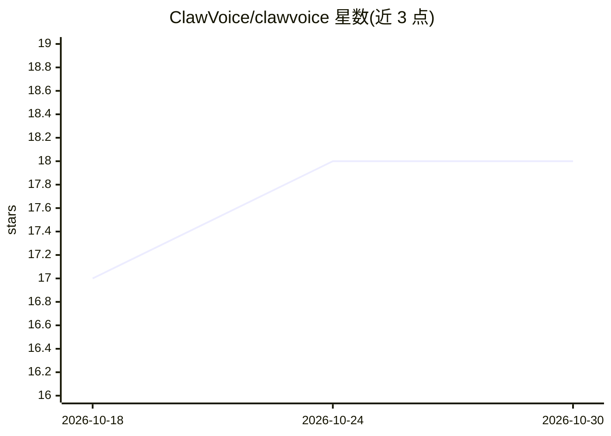

# ClawVoice/clawvoice

⭐ 18 · TypeScript · MIT · 推送 2026-08-28 · [GitHub](https://github.com/ClawVoice/clawvoice) · 组织维护

**给 OpenClaw agent 加电话能力的插件：拨接电话、短信与批量外呼**

作为 OpenClaw 的社区电话插件，把 agent 变成电话助理：通过 Twilio 或 Telnyx 号码接打 PSTN 电话、收发短信、批量外呼（单批最多 20 通）并生成 CSV 战报；语音引擎可选 ElevenLabs Conversational AI 或 Deepgram Voice Agent，Deepgram 始终负责通话转写。通话后向 Telegram/Discord/Slack 推送摘要与完整转录，语音交互与主 agent 记忆隔离，并带 AI 披露、通话时长限制等安全护栏。需公网隧道，批量外呼涉及 TCPA 合规由用户自行承担。

## 筛选速览

| 维度 | 判定 | 备注 |
|---|---|---|
| AI 角色 | `ai-ecosystem` | LLM/agent 周边工具 |
| 许可风险 | `permissive` | MIT |
| 部署形态 | `library` | 以包/库形式分发 |
| 模型依赖 | — | README 未给出锁定关系 |
| 硬件要求 | — | 无带数字的原话,不猜 |
| 安装摩擦 | `low` | 无编译、无系统依赖或容器化 |
| 成熟度 | — | 结构信号不足 |

## 能力要点

- 双语音引擎：ElevenLabs Conversational AI 或 Deepgram Voice Agent（Deepgram 固定负责转写）
- 批量外呼（单批最多 20 通）与 CSV 战报（摘要+完整转录）
- 通话后向 Telegram/Discord/Slack 推送摘要与转录文件
- 向导式安装（openclaw clawvoice setup）与健康诊断/连接测试命令

## 适用场景

- 让 agent 替我打电话预约、留言并回报摘要和转录
- 给自己的 agent 配一个真实手机号接听来电和短信
- 跑小批量外呼活动并拿到 CSV 汇总报告

## 场景标签

`语音 Agent` · 领域:对话与助手

## 证据(README 行号)

> L5: ClawVoice turns your OpenClaw agent into a phone-capable assistant. Say *"Call the dentist and schedule a cleaning f
> L11: OpenClaw already has `@openclaw/voice-call` for PSTN calling. ClawVoice is a community alternative that adds batch 
> L53: |Dual voice engines|ElevenLabs Conversational AI or Deepgram Voice Agent|

## 星数曲线

2026-10-18 17 → 2026-10-30 18（+1）

---
*卡片 v1 · prompt 1.4 · 生成 2026-10-29 · 置信度 high · 依据 README sha `bc213d7db6bb` · [字段定义](../../DATASET.md)*
