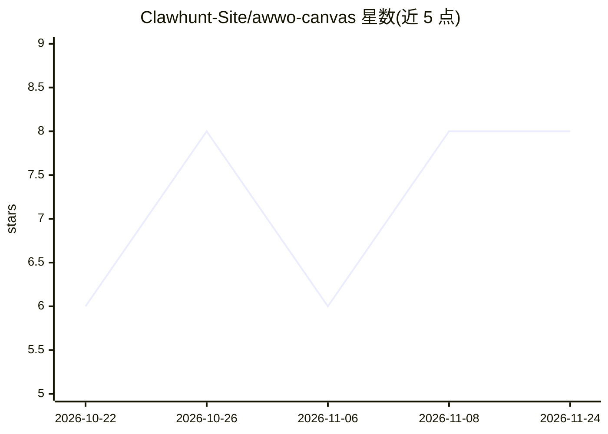

# Clawhunt-Site/awwo-canvas

⭐ 8 · TypeScript · MIT · 推送 2026-10-09 · [GitHub](https://github.com/Clawhunt-Site/awwo-canvas) · [官网](https://clawhunt.store/awwo) · 组织维护 · 中文 README

**面向开发者的智能体画布：类型化节点编排与热插拔执行器**

AwwO 智能体画布的开源版，包含三部分：画布框架（文档模型、类型化端口连线、输入输出契约、整图运行、互审 Graph、节点团队）、四种可热更新的 Markdown 编排 skill、以及热插拔执行器架构——任何实现 worker 协议 v1 的进程可通过 HTTP 协议随时接入或拔出，运行中的节点不会被中途换引擎。自带离线 Mock 执行器，不配置模型也能跑通全链路；需要 Node.js 22.12+，绑定 127.0.0.1，定位为单用户工具。MIT 许可，从上游 AwwO 于固定 commit 切出。

## 筛选速览

| 维度 | 判定 | 备注 |
|---|---|---|
| AI 角色 | `ai-ecosystem` | LLM/agent 周边工具 |
| 许可风险 | `permissive` | MIT |
| 部署形态 | `library` | 以包/库形式分发 |
| 模型依赖 | local-ok | 支持本地模型 |
| 硬件要求 | — | 无带数字的原话,不猜 |
| 安装摩擦 | `low` | 无编译、无系统依赖或容器化 |
| 成熟度 | — | 结构信号不足 |

## 能力要点

- 热插拔执行器：runtimes.json 监听、HTTP 注册或 API 接入，均不重启服务
- 四种编排 skill（画布规划/助手路由/节点交付/团队协作）为可热更新 Markdown
- OpenAI 兼容 worker 可对接任意 Chat Completions 端点，密钥仅留在 worker 进程
- 文档为唯一事实源，计划操作走封闭协议并作为可撤销的原子变更应用

## 适用场景

- 在无限画布上搭建、运行带类型化契约的多智能体图
- 用离线 Mock 执行器在不配置模型的情况下调试整条编排链路
- 接入自研或其他语言的执行进程而无需重启编排器

## 场景标签

`多智能体` `Agent 框架` · 领域:Agent 开发

## 证据(README 行号)

> L3: The open-source edition of **AwwO**'s agent canvas: an infinite canvas of agent nodes with typed
> L9: > 助手路由、节点交付格式、团队协作四种模式，全部是可热更新的 Markdown）、**热插拔执行器架构**
> L52: The OpenAI-compatible worker speaks to OpenAI, vLLM, Ollama, LM Studio, one-api/new-api relays and

## 星数曲线

2026-10-22 6 → 2026-11-24 8（+2）

---
*卡片 v1 · prompt 1.4 · 生成 2026-11-20 · 置信度 high · 依据 README sha `b058b943a7a6` · [字段定义](../../DATASET.md)*
