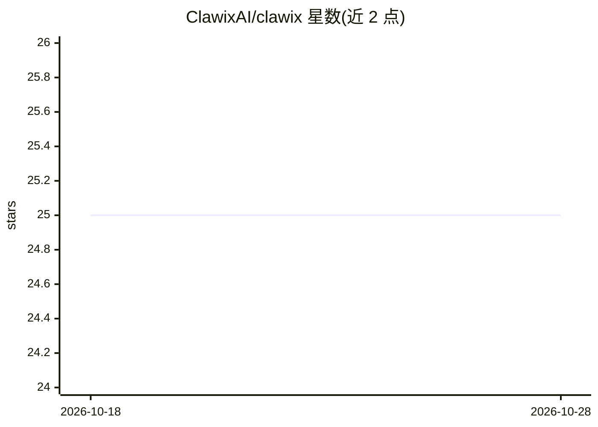

# ClawixAI/clawix

⭐ 25 · TypeScript · 推送 2026-10-21 · [GitHub](https://github.com/ClawixAI/clawix) · 组织维护

**自托管多智能体编排平台：Docker 隔离运行 agent 集群**

面向需要自建 agent 基础设施的团队：每个 AI agent 运行在独立的沙箱 Docker 容器中，具备 CPU/内存限制、只读挂载与无 root 权限；支持 swarm 编排（子 agent DAG 任务分解）、三级作用域记忆（用户/组/组织）、技能框架、RBAC、token 预算与审计日志。多渠道接入 Telegram、WhatsApp、Slack 与 Web 控制台。多 LLM 提供方支持 Anthropic/OpenAI/DeepSeek/Gemini 等，任何 OpenAI 兼容端点（Ollama、vLLM）可通过 custom provider 接入。限制：Azure/OpenRouter 为 planned 状态，WhatsApp/Slack 渠道亦为 planned；运行需 Node.js 20+、pnpm、Docker 与 Docker Compose。

## 筛选速览

| 维度 | 判定 | 备注 |
|---|---|---|
| AI 角色 | `ai-ecosystem` | LLM/agent 周边工具 |
| 许可风险 | `none` | — |
| 部署形态 | `self-host` | docker 或自建部署 |
| 模型依赖 | local-ok | 支持本地模型 |
| 硬件要求 | — | 无带数字的原话,不猜 |
| 安装摩擦 | `low` | 无编译、无系统依赖或容器化 |
| 成熟度 | — | 结构信号不足 |

## 能力要点

- 每个 agent 运行于独立沙箱 Docker 容器（CPU/内存限制、无 root）
- swarm 编排：子 agent DAG 分解、协调器聚合与失败处理
- RBAC、token 预算、审计日志与三级作用域记忆
- 多渠道交付：Telegram/Web 已可用，WhatsApp/Slack 为 planned

## 适用场景

- 在自有服务器上以容器隔离方式运行多个 AI agent
- 为团队提供带 RBAC 与 token 预算治理的 agent 服务
- 通过 Telegram 或 Web 控制台与 agent 交互

## 场景标签

`多智能体` `Agent 记忆` · 领域:Agent 开发

## 证据(README 行号)

> L3:  Self-hosted multi-agent AI orchestration platform
> L20: - **Every agent runs in its own Docker container** -- no agent can read another's files, exhaust your host's memory
> L39: Break complex tasks into sub-agent DAGs. The coordinator delegates, aggregates results, and handles failures -- all

## 星数曲线

2026-10-18 25 → 2026-10-28 25（+0）

---
*卡片 v1 · prompt 1.4 · 生成 2026-10-27 · 置信度 mid · 依据 README sha `2619471eba3e` · [字段定义](../../DATASET.md)*
