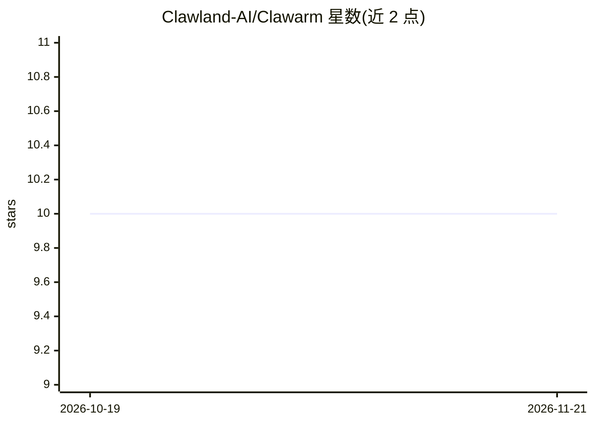

# Clawland-AI/Clawarm

⭐ 10 · Python · MIT · 推送 2026-02-22 · [GitHub](https://github.com/Clawland-AI/Clawarm) · [官网](https://clawarm.ai) · 组织维护

**通过 OpenClaw 用自然语言控制实体机械臂运动**

ClawArm 在 OpenClaw 与实体机械臂（NERO 7 自由度、Piper 6 自由度）之间架桥：用户用自然语言描述动作，无需手动关节/坐标计算。提供两种控制模式——Skill 模式由 OpenClaw 读取 agx-arm-codegen 技能生成完整 Python 控制脚本并执行，Plugin 模式提供 arm_move/arm_status/arm_stop 实时工具调用桥接服务器。内置安全层：关节限位、工作空间边界、速度上限、API/工具/物理按钮急停；支持 Mock 模式无硬件开发。需 Linux + SocketCAN 接口与 CAN 总线连接的机械臂。

## 筛选速览

| 维度 | 判定 | 备注 |
|---|---|---|
| AI 角色 | `ai-native` | 本体是模型或模型工具 |
| 许可风险 | `permissive` | MIT |
| 部署形态 | `self-host` | docker 或自建部署 |
| 模型依赖 | — | README 未给出锁定关系 |
| 硬件要求 | — | 无带数字的原话,不猜 |
| 安装摩擦 | `low` | 无编译、无系统依赖或容器化 |
| 成熟度 | — | 结构信号不足 |

## 能力要点

- 自然语言到机械臂运动，支持 NERO 7-DOF 与 Piper 6-DOF
- Skill 模式（代码生成）与 Plugin 模式（实时工具）双控制模式
- 安全层校验全部命令：关节限位、工作空间边界、速度上限（默认 80%）、急停
- Mock 模式可在无硬件环境下开发与测试

## 适用场景

- 用对话指令让机械臂抓取、放置物体或画轨迹
- 无实体机械臂时用 Mock 模式开发调试控制流程
- 通过 OpenClaw 的 web UI、飞书、Telegram 等渠道远程控制机械臂

## 场景标签

`代码生成` · 领域:编码与开发

## 证据(README 行号)

> L20: ClawArm bridges **natural language** and **physical robotic arm motion**. Built on top of OpenClaw, it lets you con
> L26: |**Natural Language Control**|"Pick up the red block" becomes actual robot motion|

## 星数曲线

2026-10-19 10 → 2026-11-21 10（+0）

---
*卡片 v1 · prompt 1.4 · 生成 2026-11-20 · 置信度 high · 依据 README sha `798ab6e57b2c` · [字段定义](../../DATASET.md)*
