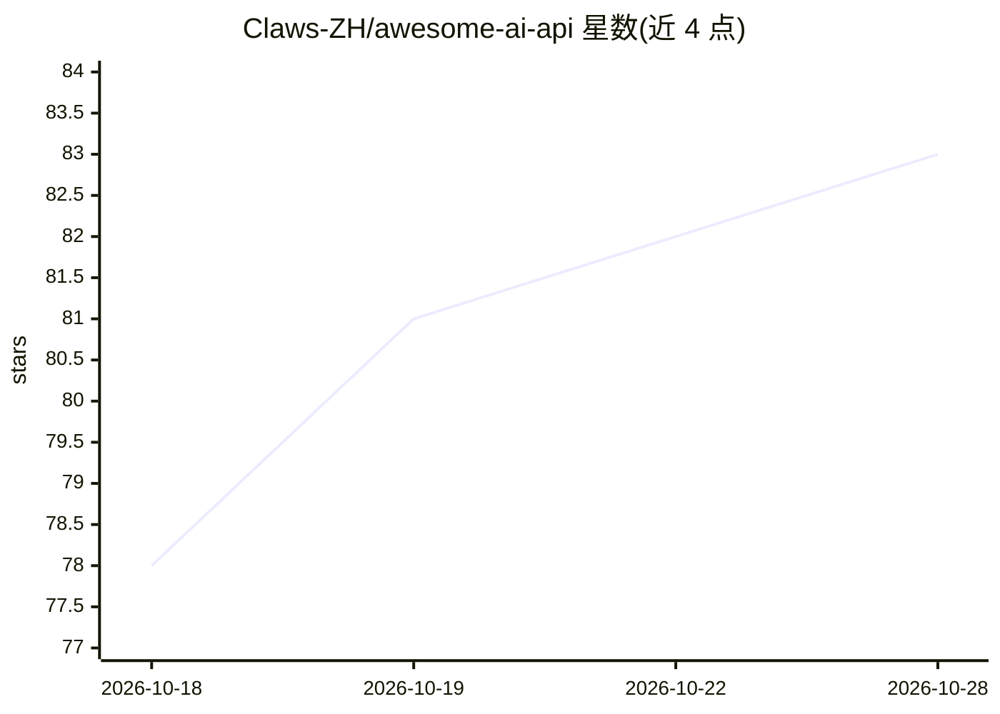

# Claws-ZH/awesome-ai-api

⭐ 83 · Python · MIT · 推送 2026-10-28 · [GitHub](https://github.com/Claws-ZH/awesome-ai-api) · [官网](https://claws-zh.github.io/awesome-ai-api/) · 个人维护 · 中文 README

**AI API 网关/中转站清单：185 家每日探测与排名**

社区维护的 AI API 网关（中转站）策展仓库：收录 185 家网关，每日 10:00 (SGT) 通过 OpenAI 兼容的 /v1/models 端点探测，生成含区域、模型、引擎指纹、支付方式、延迟与评分的排行榜；原始数据与历史快照存于 Git 仓库，含黑名单、基准测试脚本与提交模板。面向需要选购第三方 LLM API 转售服务的开发者与用户，覆盖国际与中国市场，双语（中/英）。README 明确声明无付费排名，并提示该行业存在跑路风险。

## 筛选速览

| 维度 | 判定 | 备注 |
|---|---|---|
| AI 角色 | `ai-knowledge` | 知识聚合/清单类 |
| 许可风险 | `permissive` | MIT |
| 部署形态 | `None` |  |
| 模型依赖 | — | README 未给出锁定关系 |
| 硬件要求 | — | 无带数字的原话,不猜 |
| 安装摩擦 | `low` | 无编译、无系统依赖或容器化 |
| 成熟度 | — | 结构信号不足 |

## 能力要点

- 185 家网关每日自动探测 /v1/models 端点并生成排行榜
- 检测网关底层引擎（new-api ×35、one-api ×20 等）
- 黑名单与社区举报机制（两次独立举报+14 天回应期）
- 延迟/吞吐/可靠性/定价一致性基准测试脚本

## 适用场景

- 挑选第三方 Claude/GPT/Gemini API 中转服务商
- 充值前核验网关是否有真实可用的 API 端点
- 查看中国与国际网关的价格、支付与延迟对比
- 举报或查询跑路、数据泄露的网关黑名单

## 场景标签

`精选清单` · 领域:学习与行业

## 证据(README 行号)

> L3: > The world's largest open-source hub for AI API gateways & reseller reviews.
> L18: We don't just list gateways — **we probe every one of them daily** for a real OpenAI-compatible `/v1/models` endpoi
> L66: **Total: 185 gateways** · 🔌 **89 with confirmed `/v1/models` endpoint** · 🟢 120 Verified · 🟡 6 Probable · 🧰 3 OSS ·

## 星数曲线

2026-10-18 78 → 2026-10-28 83（+5）

---
*卡片 v1 · prompt 1.4 · 生成 2026-10-24 · 置信度 high · 依据 README sha `a1a6e7dd8080` · [字段定义](../../DATASET.md)*
