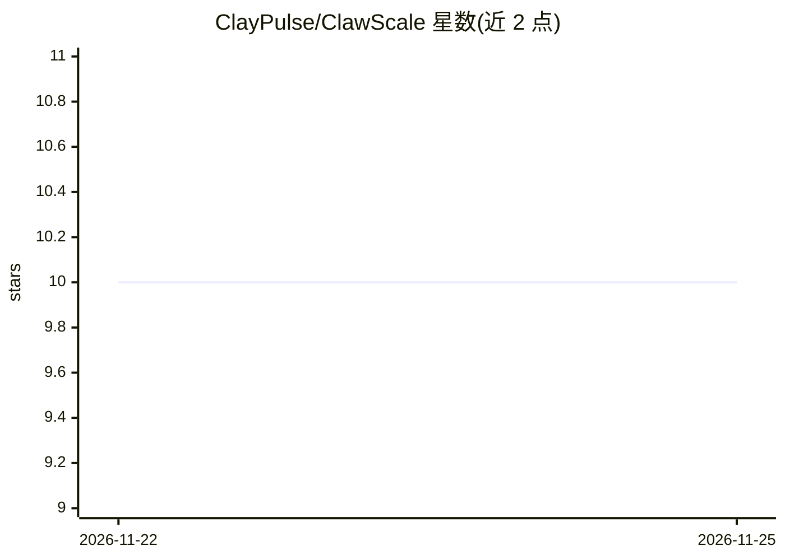

# ClayPulse/ClawScale

⭐ 10 · TypeScript · 推送 2026-04-10 · [GitHub](https://github.com/ClayPulse/ClawScale) · [官网](https://clawscale.org) · 个人维护

**多租户 IM 网关：让 AI 机器人跨 14+ 聊天平台规模化服务**

ClawScale 是一个自托管的即时通讯网关，将消息渠道层与 AI 后端层分离：渠道适配器把 WhatsApp、Discord、Telegram 等 14+ 平台的消息标准化后路由到可插拔的 AI 后端（OpenClaw、OpenAI、Anthropic、OpenRouter、本地 CLI agent 或任意 OpenAI 兼容端点），每个用户的对话、记忆与状态相互隔离。提供 Next.js 仪表盘管理渠道与后端、面向终端用户的可白标接入页、聊天内命令、附件透传、RBAC 与审计日志。技术栈为 Hono + Prisma + PostgreSQL，MIT 许可。

## 筛选速览

| 维度 | 判定 | 备注 |
|---|---|---|
| AI 角色 | `ai-ecosystem` | LLM/agent 周边工具 |
| 许可风险 | `none` | — |
| 部署形态 | `self-host` | docker 或自建部署 |
| 模型依赖 | local-ok | 支持本地模型 |
| 硬件要求 | — | 无带数字的原话,不猜 |
| 安装摩擦 | `low` | 无编译、无系统依赖或容器化 |
| 成熟度 | — | 结构信号不足 |

## 能力要点

- 14+ IM 平台统一接入，单仪表盘管理，QR 扫码/OAuth 等多种连接方式
- 多后端混用：同一租户可同时接入 OpenClaw、GPT、Claude、OpenRouter、自托管模型
- 多租户隔离：每用户独立的对话、记忆与状态；RBAC、审计日志、黑白名单访问控制
- CLI Bridge 通过 WebSocket 隧道接入本地 CLI agent，无需公网 IP

## 适用场景

- 为企业客服机器人统一接入 WhatsApp、微信、Telegram 等多渠道
- 部署一套自托管网关让大量用户同时与多个 AI agent 对话
- 把本地运行的 Claude Code 等 CLI agent 通过隧道暴露给聊天平台用户

## 场景标签

`聊天机器人` `模型网关` · 领域:Agent 开发

## 证据(README 行号)

> L7: ClawScale is the fastest, simplest way to set up AI-powered chatbots across WhatsApp, Discord, Slack, Telegram, and 
> L96: 3. ClawScale routes the message to the right AI backend(s), keeping each user's conversation history isolated
> L221: |**Architecture**|Monolithic — gateways + agent in one process|Decoupled — gateway layer + pluggable agent backend

## 星数曲线

2026-11-22 10 → 2026-11-25 10（+0）

---
*卡片 v1 · prompt 1.4 · 生成 2026-11-22 · 置信度 high · 依据 README sha `40aec1abb7fa` · [字段定义](../../DATASET.md)*
