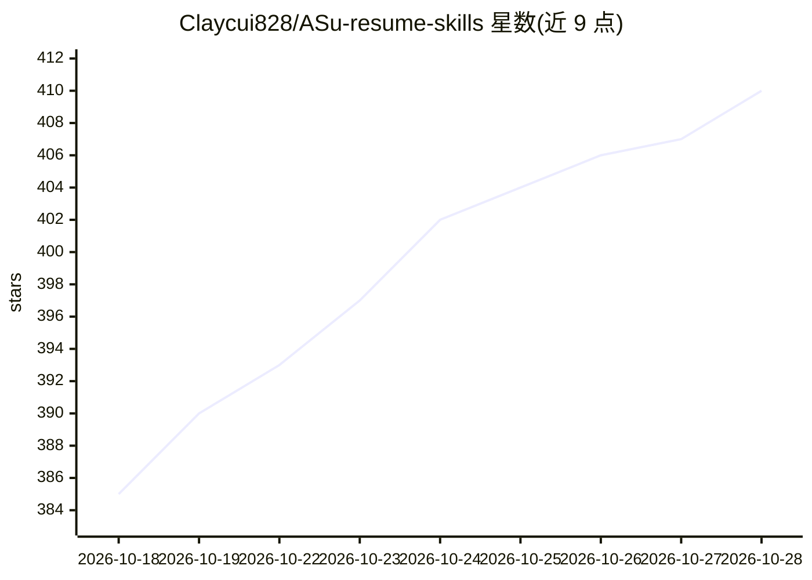

# Claycui828/ASu-resume-skills

⭐ 411 · Python · MIT · 推送 2026-08-23 · [GitHub](https://github.com/Claycui828/ASu-resume-skills) · 个人维护 · 中文 README

**面向 Codex 的简历生成与证据审计技能插件**

由两个 Codex Skill 组成的插件仓库：asu-resume-skill 读取用户简历、飞书文档、截图与项目材料，核验学校官方 Title，将项目拆成 Data/Model/Training/Serving/Agent/Eval 技术链，生成边界明确的 Owner、0→1 叙事，输出自包含 HTML、A4 PDF 与小红书配文；asu-resume-audit-skill 把简历逐条拆成原子主张并生成证据矩阵，每条标记已证实/部分证实/存在直接矛盾/缺乏支持/暂不可核验五种状态之一，输出 HTML/PDF 审计报告。通过向 Codex 发送仓库地址安装，MIT 协议。技能执行依赖 Codex 环境，仓库本身不含独立运行入口。

## 筛选速览

| 维度 | 判定 | 备注 |
|---|---|---|
| AI 角色 | `ai-ecosystem` | LLM/agent 周边工具 |
| 许可风险 | `permissive` | MIT |
| 部署形态 | `None` |  |
| 模型依赖 | — | README 未给出锁定关系 |
| 硬件要求 | — | 无带数字的原话,不猜 |
| 安装摩擦 | `low` | 无编译、无系统依赖或容器化 |
| 成熟度 | — | 结构信号不足 |

## 能力要点

- 读取简历/飞书文档/截图，核验学校官方 Title 后生成高密度履历（HTML/PDF/配文）
- 审计 Skill 将简历拆为原子主张，输出五状态证据矩阵与审计报告
- 定义事实边界：区分参与与 Owner、已交付与规划中，阻止无来源指标进入成品
- 以 Codex 插件形式提供，安装后经对话调用

## 适用场景

- 我把真实晋升材料整理成高密度中文技术履历并导出 PDF
- 投递前让 AI 逐条审计简历中的角色强度、指标口径与时间线
- 按审计报告补证据后回写简历再生成终稿

## 场景标签

`AI 写作` · 领域:内容生成

## 证据(README 行号)

> L27: 把下面这段直接发给 Codex：
> L30: 请从这个 GitHub 仓库安装插件，并启用 asu-resume-skill 与 asu-resume-audit-skill：
> L119: ├── .codex-plugin/

## 星数曲线

2026-10-18 385 → 2026-10-28 410（+25）

---
*卡片 v1 · prompt 1.4 · 生成 2026-10-21 · 置信度 mid · 依据 README sha `0c184fe8fedc` · [字段定义](../../DATASET.md)*
