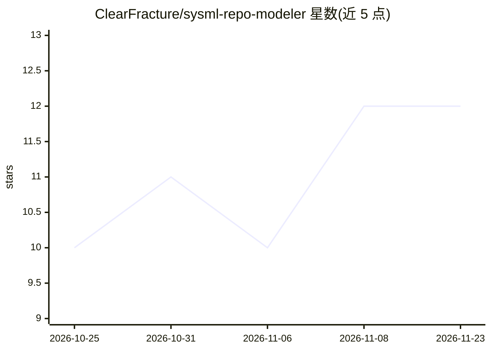

# ClearFracture/sysml-repo-modeler

⭐ 12 · Python · MIT · 推送 2026-09-22 · [GitHub](https://github.com/ClearFracture/sysml-repo-modeler) · [官网](https://www.belvederelabs.ai/project-analyzer) · 组织维护

**自托管 AI 工具：把 GitHub 仓库转为 SysML v2 架构模型与交互图**

自托管的 AI 分析工具：用户添加一个或多个 GitHub 仓库，OpenCode 分两遍读取源码（先识别结构与连接，再补充组件用途），生成 SysML v2 架构模型；随后对模型做可渲染性与覆盖率校验，并通过定向修复提示改进。结果以 SysML v2 代码和可交互架构图呈现，支持搜索部件/端口、过滤连接、版本化保存每次扫描。技术栈为 FastAPI + PostgreSQL + React，通过 Docker Compose 启动完整本地栈，源码与生成的模型保留在用户自有环境中。

## 筛选速览

| 维度 | 判定 | 备注 |
|---|---|---|
| AI 角色 | `ai-native` | 本体是模型或模型工具 |
| 许可风险 | `permissive` | MIT |
| 部署形态 | `self-host` | docker 或自建部署 |
| 模型依赖 | — | README 未给出锁定关系 |
| 硬件要求 | — | 无带数字的原话,不猜 |
| 安装摩擦 | `low` | 无编译、无系统依赖或容器化 |
| 成熟度 | — | 结构信号不足 |

## 能力要点

- OpenCode 两遍分析仓库并生成 SysML v2 模型
- 可渲染性与覆盖率校验及定向修复提示
- 交互式架构图：搜索部件、过滤连接、下钻组件
- 扫描结果版本化保存，可回看与对比

## 适用场景

- 把由多个服务组成的系统建模为统一的 SysML v2 架构模型
- 追踪跨仓库的组件连接关系
- 在私有环境中分析公开与私有仓库并保留模型

## 场景标签

 · 领域:开发者工具/系统建模

## 证据(README 行号)

> L7: A self-hosted AI analysis harness reads the source, traces components and
> L31: OpenCode to read one repository or many as a single
> L45: 2. **Read the system as a whole.** OpenCode analyzes the repositories in two

## 星数曲线

2026-10-25 10 → 2026-11-23 12（+2）

---
*卡片 v1 · prompt 1.4 · 生成 2026-11-18 · 置信度 high · 依据 README sha `0860f38752db` · [字段定义](../../DATASET.md)*
