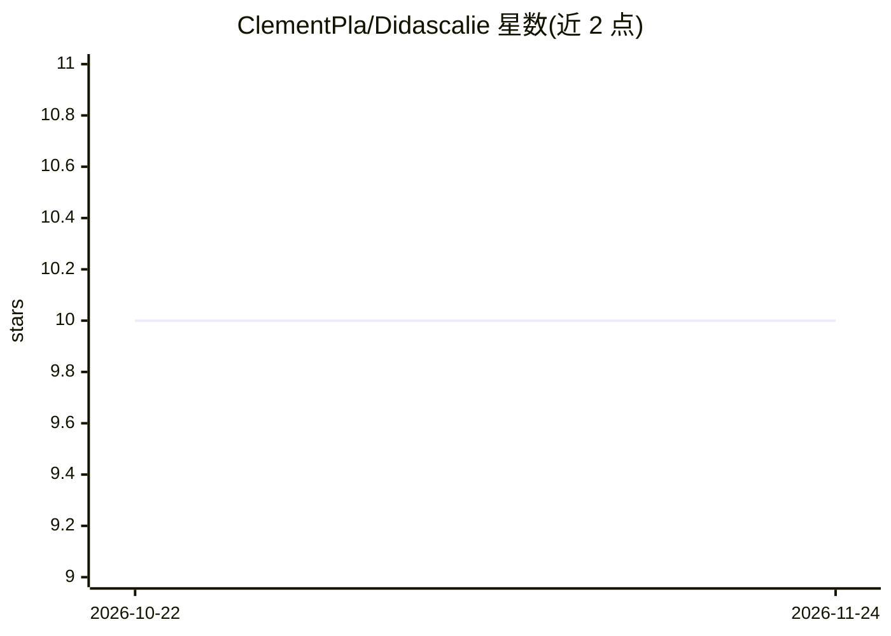

# ClementPla/Didascalie

⭐ 10 · TypeScript · BSD-3-Clause · 推送 2026-11-17 · [GitHub](https://github.com/ClementPla/Didascalie) · [官网](https://didascalie.readthedocs.io/en/latest/) · 个人维护

**给临床与科研人员的本地医学图像标注桌面工具**

桌面端医学图像标注工具，支持分割掩码、矢量形状、分类标签、关键点与帧配准，可标注千兆像素切片与多通道显微图像；多标注者账号协作并输出 Dice/IoU/kappa 一致性报告。全部绘制、图像处理与小模型训练在本机完成，无服务器、不上传数据；一个项目对应一个 SQLite 格式的 .dida 文件。配套 pydidascalie 库可离线读写项目并与 COCO/YOLO 互转。Windows/macOS/Linux 提供安装包，另有 Android 平板 APK。

## 筛选速览

| 维度 | 判定 | 备注 |
|---|---|---|
| AI 角色 | `ai-enhanced` | 去掉 AI 部分产品仍成立 |
| 许可风险 | `permissive` | BSD-3-Clause |
| 部署形态 | `desktop` | 安装包/桌面程序 |
| 模型依赖 | — | README 未给出锁定关系 |
| 硬件要求 | — | 无带数字的原话,不猜 |
| 安装摩擦 | `medium` | 含编译或系统依赖之一 |
| 成熟度 | `idea` | |

## 能力要点

- 分割掩码与矢量形状双向转换，同图共存
- 在自有标注上拟合小分割头，秒级到分钟级完成辅助标注训练
- 千兆像素显微切片按分辨率金字塔全分辨率标注，支持 CZI/LIF/ND2/OME-TIFF
- 多标注者独立标注与一致性报告页

## 适用场景

- 临床与科研影像的分割和分类标注
- 多人协作标注并统计评分者间一致性
- 显微与 16 位大图的本地离线标注
- 将模型预测写入项目供人工修正的预标注流程

## 场景标签

`科研工具` · 领域:学习与行业

## 证据(README 行号)

> L22: Didascalie annotates medical images with segmentation masks, vector shapes, classification labels and keypoints. Dr
> L57: **A model trained on your data.** Scribble on a few frames and Didascalie fits a small segmentation head, then appl
> L24: It started as a personal project, out of frustration with the tools I knew. Many researchers and clinicians still a

## 星数曲线

2026-10-22 10 → 2026-11-24 10（+0）

---
*卡片 v1 · prompt 1.4 · 生成 2026-11-20 · 置信度 mid · 依据 README sha `48ee82e17e47` · [字段定义](../../DATASET.md)*
