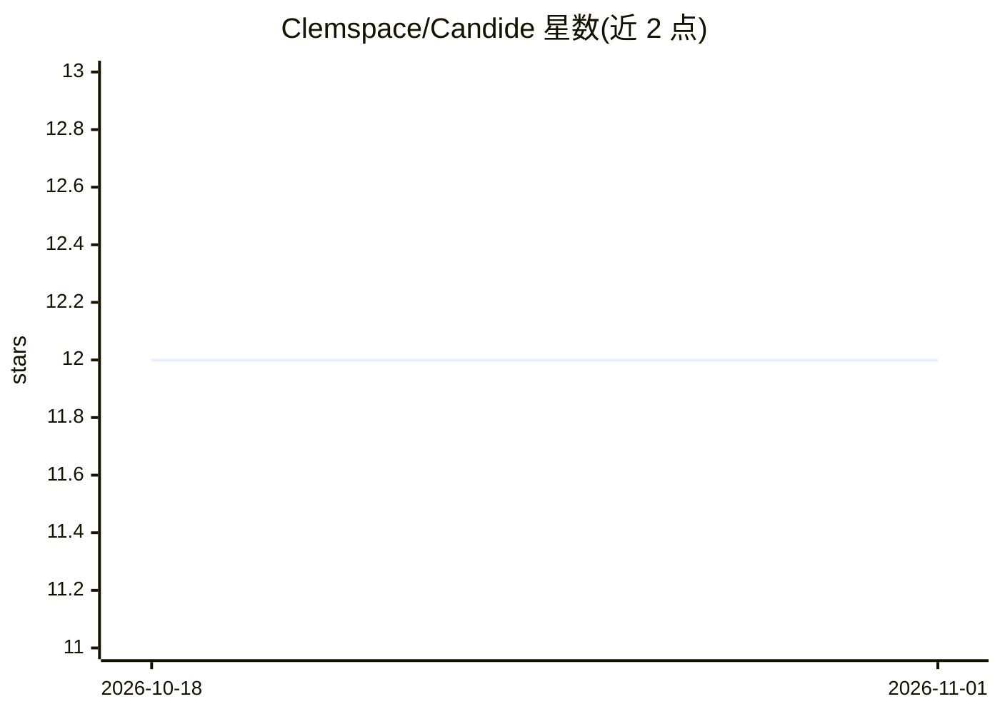

# Clemspace/Candide

⭐ 12 · Python · MIT · 推送 2026-02-11 · [GitHub](https://github.com/Clemspace/Candide) · 组织维护

**面向研究的透明 Transformer 训练框架，供研究者与学生使用**

由索邦大学等机构 ModERN 团队开发的 transformer 语言模型训练框架（Python 包名 ramanujan），主打架构与训练决策的可解释、可复现：内置 GQA、RoPE、滑动窗口注意力、SwiGLU、RMSNorm 等结构，以及基于 Ramanujan 图的结构化稀疏、语义熵损失、WSD 调度器等技术；支持 AdamW/Muon/AdEMAMix 优化器、混合精度、梯度检查点与多 GPU DDP，集成 Weights & Biases。提供 35M–350M 多档配置。面向探索新架构的研究者、学习 transformer 内部的学生与有限算力下的工程师。需 Python 3.8+、PyTorch 2.0+（CUDA 11.8+），tiny 配置需 8GB+ 显存。

## 筛选速览

| 维度 | 判定 | 备注 |
|---|---|---|
| AI 角色 | `ai-ecosystem` | LLM/agent 周边工具 |
| 许可风险 | `permissive` | MIT |
| 部署形态 | `library` | 以包/库形式分发 |
| 模型依赖 | — | README 未给出锁定关系 |
| 硬件要求 | — | 无带数字的原话,不猜 |
| 安装摩擦 | `medium` | 含编译或系统依赖之一 |
| 成熟度 | — | 结构信号不足 |

## 能力要点

- Ramanujan 图结构化稀疏（宣称 80-90% 稀疏度）
- GQA/RoPE/滑动窗口注意力/SwiGLU/RMSNorm 架构组件
- 多优化器、混合精度、梯度检查点与多 GPU DDP 支持
- 35M/100M/350M 多档计算预算配置与确定性训练

## 适用场景

- 在有限算力上原型化高效语言模型架构
- 学习与研究 transformer 内部实现与训练机制
- 用不同稀疏度与优化器做可复现的消融实验

## 场景标签

`模型训练` `科研工具` · 领域:学习与行业

## 证据(README 行号)

> L5: A research framework for training efficient transformer language models with mathematical rigor and transparency. Na
> L15: Candide is a research-focused transformer framework that prioritizes:

## 星数曲线

2026-10-18 12 → 2026-11-01 12（+0）

---
*卡片 v1 · prompt 1.4 · 生成 2026-11-01 · 置信度 mid · 依据 README sha `2d65a6f02d10` · [字段定义](../../DATASET.md)*
