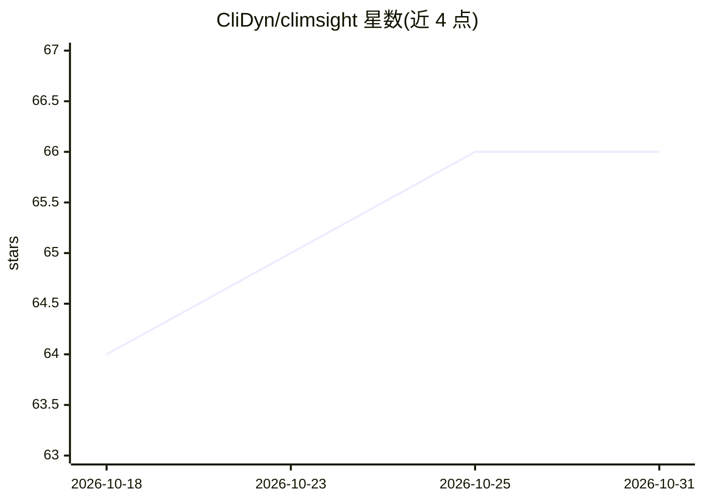

# CliDyn/climsight

⭐ 66 · Python · BSD-3-Clause · 推送 2026-03-27 · [GitHub](https://github.com/CliDyn/climsight) · 组织维护

**AI 气候决策支持系统：LLM 结合多源气候数据生成局地评估**

面向研究者、政策制定者与农业/城市规划者的气候决策支持系统。多个专用 agent（智能、数据分析、检索）编排数据获取、沙箱 Jupyter 内核中编写并执行分析代码，以及答案综合；结合 nextGEMS、CMIP6、DestinE、ERA5 等多源气候数据与 IPCC 报告等文献的 RAG 检索。提供 React+FastAPI 与旧版 Streamlit 两种界面，在交互地图上点击任意地点提问即可获得该位置的气候评估。需配置 LLM API key，部分数据（如 DestinE 约 12GB）为可选下载。

## 筛选速览

| 维度 | 判定 | 备注 |
|---|---|---|
| AI 角色 | `ai-native` | 本体是模型或模型工具 |
| 许可风险 | `permissive` | BSD-3-Clause |
| 部署形态 | `self-host` | docker 或自建部署 |
| 模型依赖 | — | README 未给出锁定关系 |
| 硬件要求 | — | 无带数字的原话,不猜 |
| 安装摩擦 | `low` | 无编译、无系统依赖或容器化 |
| 成熟度 | — | 结构信号不足 |

## 能力要点

- 多 agent 流水线自主编排数据检索、代码执行与综合
- 整合 nextGEMS/ICCP/AWI-CM CMIP6/DestinE/ERA5 等多源气候数据
- RAG 检索 IPCC 报告与科学文献增强回答
- agent 在沙箱 Jupyter 内核中编写并运行分析代码

## 适用场景

- 在地图上选择任意地点获取本地化气候影响评估
- 为农业规划或城市开发决策查询气候变化影响
- 批量生成与验证气候问题（sequential/ 工具）

## 场景标签

`多智能体` `数据分析` `RAG` `科研工具` · 领域:Agent 开发

## 证据(README 行号)

> L3: ClimSight is an AI-powered climate decision-support system that combines Large Language Models with multi-source cli
> L9: - **Agentic AI pipeline** — specialized agents (smart agent, data analysis agent, search agent) orchestrate data ret

## 星数曲线

2026-10-18 64 → 2026-10-31 66（+2）

---
*卡片 v1 · prompt 1.4 · 生成 2026-10-24 · 置信度 high · 依据 README sha `975f06ca6a0f` · [字段定义](../../DATASET.md)*
