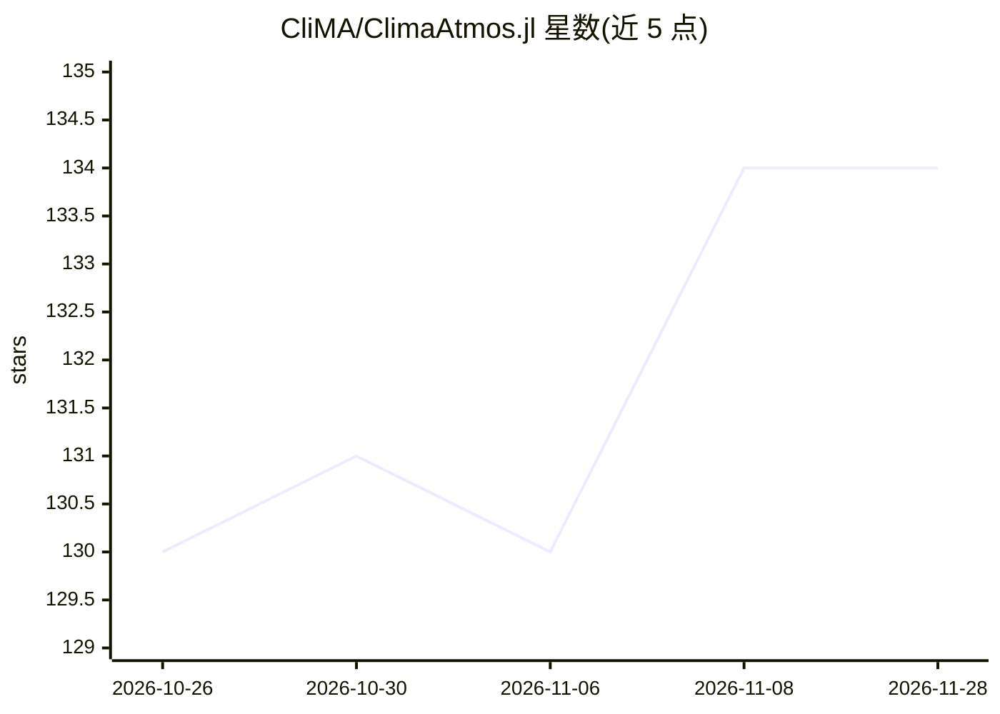

# CliMA/ClimaAtmos.jl

⭐ 134 · Julia · Apache-2.0 · 推送 2026-11-27 · [GitHub](https://github.com/CliMA/ClimaAtmos.jl) · [官网](https://clima.github.io/ClimaAtmos.jl/dev/) · 组织维护

**面向科研的大气模式组件：支持GPU、可校准的全球大气模拟**

CliMA 地球系统模式中的大气分量，以 Julia 包形式发布。在立方球网格与柱状网格上求解可压缩大气运动方程，包含湍流与对流参数化（PROPHET/EDMF）、云微物理与辐射（RRTMGP），支持 ERA5 初边值条件、NetCDF/HDF5 诊断输出与断点续算。同一代码库可运行于 CPU 与 NVIDIA GPU，提供脚本与 YAML 两种配置方式，可配置全局或单柱模拟。设计目标为结合数据同化与机器学习进行参数校准。

## 筛选速览

| 维度 | 判定 | 备注 |
|---|---|---|
| AI 角色 | `ai-enhanced` | 去掉 AI 部分产品仍成立 |
| 许可风险 | `permissive` | Apache-2.0 |
| 部署形态 | `None` |  |
| 模型依赖 | — | README 未给出锁定关系 |
| 硬件要求 | `cpu-ok` | |
| 安装摩擦 | `low` | 无编译、无系统依赖或容器化 |
| 成熟度 | — | 结构信号不足 |

## 能力要点

- 同一代码库运行于 CPU 与 NVIDIA GPU
- PROPHET（扩展 prognostic EDMF）湍流对流方案，支持数据同化与机器学习校准
- 0-moment 至 2-moment 云微物理方案及 P3 冰相方案
- YAML 配置接口与 NetCDF/HDF5 可配置诊断输出

## 适用场景

- 运行全球或单柱大气模拟实验（如 BOMEX、DYCOMS、RICO 标准算例）
- 利用 ERA5 数据驱动的初始条件做模拟研究
- 在 GPU 上开展高分辨率气候模拟
- 作为 CliMA 地球系统模式的组件参与海陆冰耦合模拟

## 场景标签

`科研工具` · 领域:学习与行业

## 证据(README 行号)

> L5: The atmosphere model of the CliMA Earth System Model: a GPU-capable global atmosphere model designed for calibration
> L25:  - **Turbulence and convection**: TKE-based eddy diffusion and the PROPHET scheme (an extended, prognostic eddy-dif
> L31:  - **GPU support**: runs on CPUs and NVIDIA GPUs from the same codebase

## 星数曲线

2026-10-26 130 → 2026-11-28 134（+4）

---
*卡片 v1 · prompt 1.4 · 生成 2026-11-28 · 置信度 mid · 依据 README sha `ddede904249c` · [字段定义](../../DATASET.md)*
