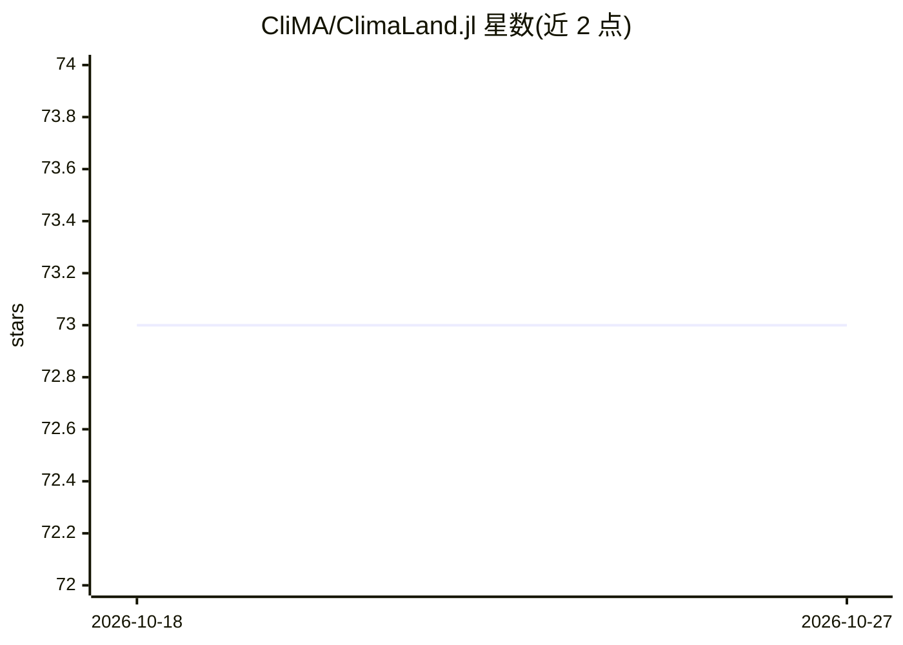

# CliMA/ClimaLand.jl

⭐ 73 · Julia · Apache-2.0 · 推送 2026-10-26 · [GitHub](https://github.com/CliMA/ClimaLand.jl) · [官网](https://clima.github.io/ClimaLand.jl/) · 组织维护

**CliMA 地球系统模型的模块化陆面模拟器，支持数据驱动参数化**

Julia 语言编写的陆面过程模型，属于 CliMA 地球系统模型的陆面分量。提供组件模型（土壤 RichardsModel/EnergyHydrology、冠层 CanopyModel、积雪 SnowModel、土壤CO2）与组合模型（SoilCanopyModel、LandModel），可单分量独立运行或多分量耦合运行，支持单柱、区域与全球尺度模拟，CPU 与 GPU 均可运行。设计目标之一是支持数据驱动参数化。面向气候建模与水文学科研用户，通过 Julia Pkg 安装；SoilCO2Model 处于 beta 版本。

## 筛选速览

| 维度 | 判定 | 备注 |
|---|---|---|
| AI 角色 | `ai-enhanced` | 去掉 AI 部分产品仍成立 |
| 许可风险 | `permissive` | Apache-2.0 |
| 部署形态 | `None` |  |
| 模型依赖 | — | README 未给出锁定关系 |
| 硬件要求 | — | 无带数字的原话,不猜 |
| 安装摩擦 | `low` | 无编译、无系统依赖或容器化 |
| 成熟度 | — | 结构信号不足 |

## 能力要点

- 组件模型可独立或耦合运行（土壤/冠层/积雪/土壤CO2）
- 支持单柱、区域框与全球尺度模拟
- CPU 与 GPU 兼容
- 为数据驱动参数化而设计

## 适用场景

- 模拟土壤水分能量、冠层与积雪等陆面过程
- 作为地球系统模型的陆面分量进行耦合
- 开展支持机器学习参数化的陆面建模研究

## 场景标签

 · 领域:地球系统科学/气候建模

## 证据(README 行号)

> L15: This is the repository of the CliMA land model code. Here are some notable features:
> L18: - ClimaLand is CPU and GPU compatible
> L21: For more information, read our manuscript: Deck, Katherine, et al. "ClimaLand: A land surface model designed to ena

## 星数曲线

2026-10-18 73 → 2026-10-27 73（+0）

---
*卡片 v1 · prompt 1.4 · 生成 2026-10-24 · 置信度 high · 依据 README sha `bedda1122000` · [字段定义](../../DATASET.md)*
