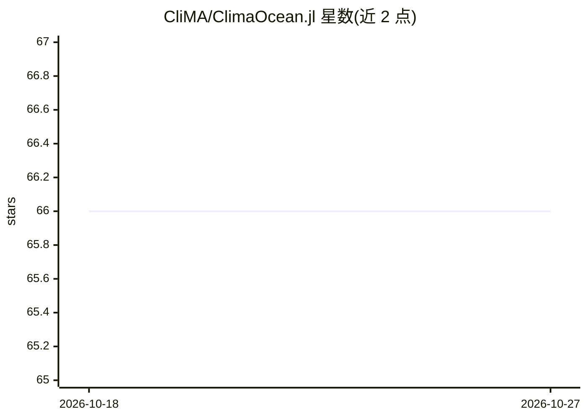

# CliMA/ClimaOcean.jl

⭐ 66 · Julia · NOASSERTION · 推送 2026-10-24 · [GitHub](https://github.com/CliMA/ClimaOcean.jl) · [官网](https://clima.github.io/ClimaOceanDocumentation/stable/) · 组织维护

**给气候研究者的区域到全球海洋与海冰耦合模拟框架**

基于 Julia 语言 Oceananigans 与 ClimaSeaIce 构建的海洋及海洋+海冰耦合模拟框架：核心抽象 OceanSeaIceModel 封装海洋模拟、海冰模拟与 prescribed 大气状态并指定三者间的通信方式；ocean_simulation 工具配置 TEOS-10 状态方程、CATKE 涡流闭合与 WENO 平流方案；另提供地形、温盐、海流与大气态数据集的处理工具。README 报告在 Nvidia H100 GPU 上约达每天墙钟时间 8 个模拟年。通用耦合框架正迁往 NumericalEarth.jl，本包将保留为聚焦海洋/海冰模拟的包。

## 筛选速览

| 维度 | 判定 | 备注 |
|---|---|---|
| AI 角色 | `ai-enhanced` | 去掉 AI 部分产品仍成立 |
| 许可风险 | `none` | NOASSERTION |
| 部署形态 | `None` |  |
| 模型依赖 | — | README 未给出锁定关系 |
| 硬件要求 | — | 无带数字的原话,不猜 |
| 安装摩擦 | `low` | 无编译、无系统依赖或容器化 |
| 成熟度 | — | 结构信号不足 |

## 能力要点

- OceanSeaIceModel 封装海洋、海冰与 prescribed 大气三方耦合
- ocean_simulation 预配置 TEOS-10、CATKE 涡流闭合与 WENO 平流
- 地形/温盐/海流/大气态数据集处理工具
- 支持 GPU 运行，README 报告 H100 上约 8 模拟年/天

## 适用场景

- 运行区域到全球尺度的真实海洋模拟
- 构建海洋与海冰耦合的气候模拟实验
- 复用 Oceananigans 特性做海洋模拟脚本开发

## 场景标签

 · 领域:气候/海洋科学计算

## 证据(README 行号)

> L3:  🌎 A framework for realistic ocean-only and coupled ocean + sea-ice simulations driven by prescribed atmospheres and
> L39: Our system for realistic modeling is anchored by `ClimaOcean.OceanSeaIceModel`, which encapsulates the ocean simula

## 星数曲线

2026-10-18 66 → 2026-10-27 66（+0）

---
*卡片 v1 · prompt 1.4 · 生成 2026-10-24 · 置信度 mid · 依据 README sha `b48e3b33db24` · [字段定义](../../DATASET.md)*
