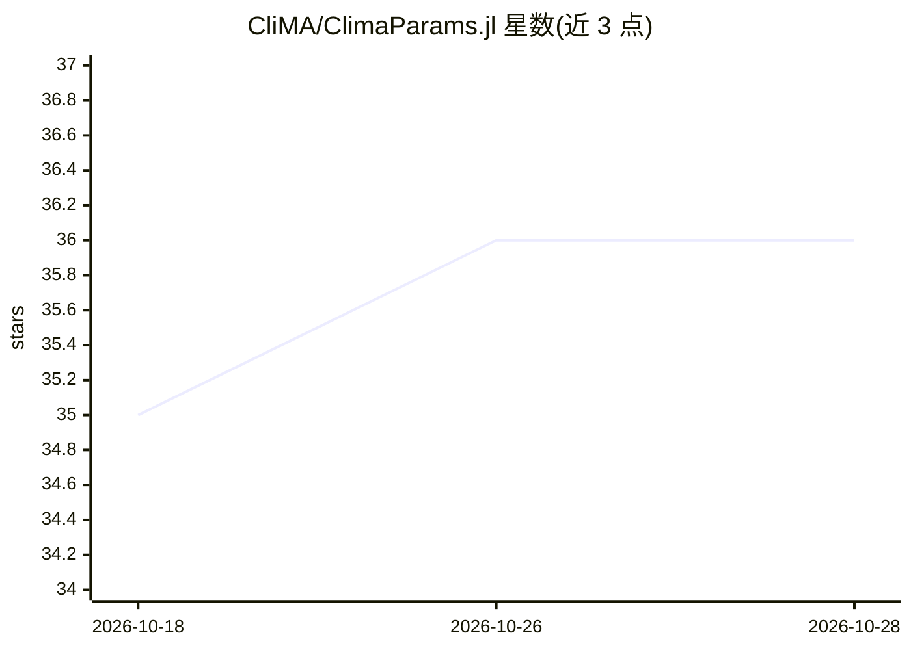

# CliMA/ClimaParams.jl

⭐ 36 · Julia · Apache-2.0 · 推送 2026-10-22 · [GitHub](https://github.com/CliMA/ClimaParams.jl) · 组织维护

**CliMA 气候建模生态的参数与物理常数集中管理库**

面向 CliMA 地球系统建模生态的 Julia 包，用 TOML 文件统一管理物理常数、行星属性与可调参数，读取时转换为带类型的 Julia 值。参数条目可携带先验分布与约束等校准元数据，供 EnsembleKalmanProcesses.jl 直接读取以进行集合卡尔曼校准。提供实验级覆盖文件合并、按组件分组检索、读取日志与可复现参数输出，行星属性命名通用化以支持多行星。基于 Julia 标准库 TOML 实现，无 CliMA 依赖。

## 筛选速览

| 维度 | 判定 | 备注 |
|---|---|---|
| AI 角色 | `ai-ecosystem` | LLM/agent 周边工具 |
| 许可风险 | `permissive` | Apache-2.0 |
| 部署形态 | `None` |  |
| 模型依赖 | — | README 未给出锁定关系 |
| 硬件要求 | — | 无带数字的原话,不猜 |
| 安装摩擦 | `low` | 无编译、无系统依赖或容器化 |
| 成熟度 | — | 结构信号不足 |

## 能力要点

- TOML 声明参数并返回 Float32/Float64/Int/String/Bool/DateTime 等类型化 Julia 值
- 参数条目可携带 prior 与 constraint 校准元数据，供 EnsembleKalmanProcesses.jl 使用
- 实验级覆盖文件系统，优先级与逐属性合并规则明确
- 每次读取均记录日志，可输出复现该次运行的完整参数文件

## 适用场景

- 统一管理大气/海洋/陆面等多组件共享的参数，避免数值漂移
- 为集合卡尔曼数据同化或机器学习校准提供先验与约束
- 记录并复现每次模拟使用的确切参数集

## 场景标签

 · 领域:地球系统建模/科学计算

## 证据(README 行号)

> L7: ClimaParams.jl is the single source of truth for the physical constants, planetary properties, and tunable parameter
> L25: - **Model parameters**: tunable values subject to calibration by data assimilation or machine learning, spanning at
> L31: - **Calibration metadata**: a parameter entry can carry a `prior` distribution and a `constraint` — the transformat

## 星数曲线

2026-10-18 35 → 2026-10-28 36（+1）

---
*卡片 v1 · prompt 1.4 · 生成 2026-10-25 · 置信度 high · 依据 README sha `2726a6aa3457` · [字段定义](../../DATASET.md)*
