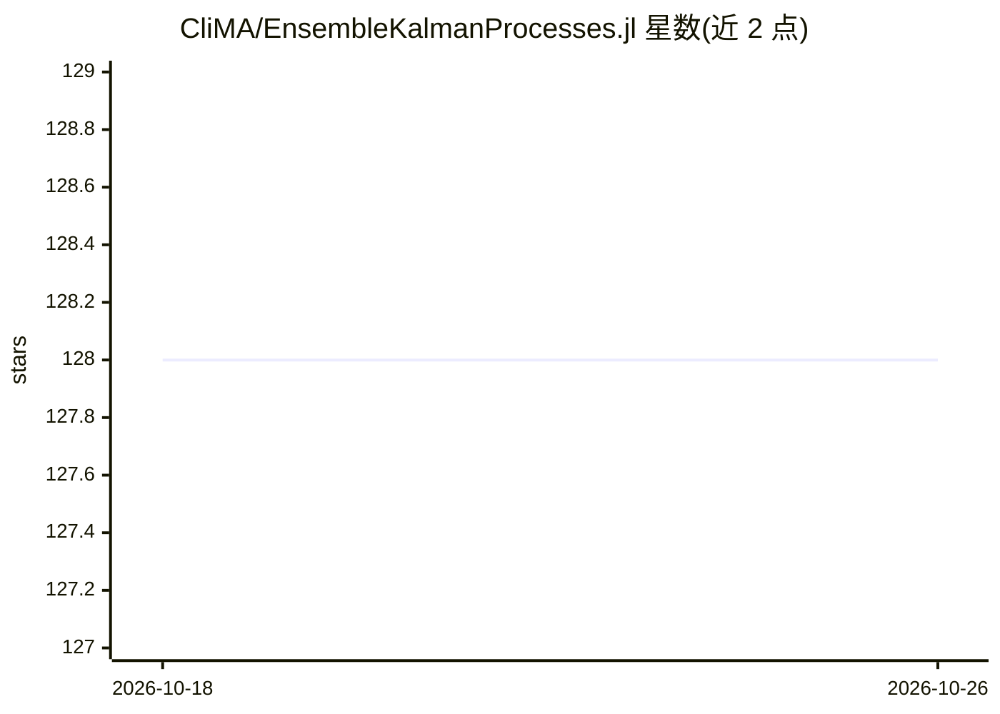

# CliMA/EnsembleKalmanProcesses.jl

⭐ 128 · Julia · Apache-2.0 · 推送 2026-10-19 · [GitHub](https://github.com/CliMA/EnsembleKalmanProcesses.jl) · [官网](https://clima.github.io/EnsembleKalmanProcesses.jl/dev) · 组织维护

**面向昂贵模型的免导数参数校准与不确定性量化 Julia 库**

EnsembleKalmanProcesses.jl (EKP) 用于求解逆问题：为计算机模型 G 寻找拟合含噪观测数据 y 的参数，并提供近似不确定性量化。实现集合卡尔曼反演、采样、无迹变换、Gauss–Newton 等多种变体，统一接口切换。免导数，前向模型可用任意语言编写；集合评估可并行以利用 HPC。以注册 Julia 包形式提供，需 Julia LTS 及以上版本。仓库另附带 Claude Code 技能用于维护任务。

## 筛选速览

| 维度 | 判定 | 备注 |
|---|---|---|
| AI 角色 | `ai-native` | 本体是模型或模型工具 |
| 许可风险 | `permissive` | Apache-2.0 |
| 部署形态 | `None` |  |
| 模型依赖 | — | README 未给出锁定关系 |
| 硬件要求 | — | 无带数字的原话,不猜 |
| 安装摩擦 | `low` | 无编译、无系统依赖或容器化 |
| 成熟度 | — | 结构信号不足 |

## 能力要点

- 免导数：只需在不同参数值处运行前向模型
- 语言无关：G 无需用 Julia 编写
- 多种集合卡尔曼变体共享统一接口
- 集合评估可并行以利用 HPC 资源

## 适用场景

- 为昂贵计算模型标定参数并量化不确定性
- HPC 上运行大规模集合校准流水线
- 在含噪、复杂参数-数据地形下做逆问题求解

## 场景标签

 · 领域:科学计算/机器学习

## 证据(README 行号)

> L3: Derivative-free optimization and approximate uncertainty quantification, built on ensemble Kalman methods.
> L5: EnsembleKalmanProcesses.jl (EKP) helps you find (locally) optimal parameters `u` for a computer model `G` so that it
> L20: - **Derivative-free**: no gradients of the forward model `G` are required — you only need to run it at different pa

## 星数曲线

2026-10-18 128 → 2026-10-26 128（+0）

---
*卡片 v1 · prompt 1.4 · 生成 2026-10-23 · 置信度 mid · 依据 README sha `f496aaffc186` · [字段定义](../../DATASET.md)*
