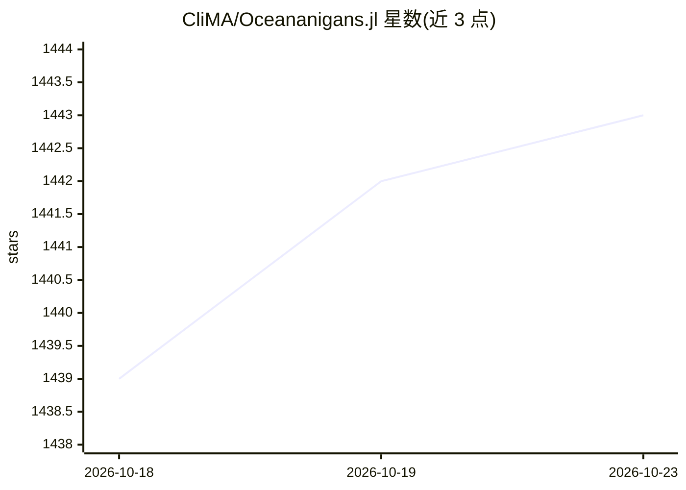

# CliMA/Oceananigans.jl

⭐ 1,443 · Julia · MIT · 推送 2026-10-22 · [GitHub](https://github.com/CliMA/Oceananigans.jl) · [官网](https://clima.github.io/OceananigansDocumentation/stable) · 组织维护

**Julia 写的海洋流体动力学有限体积模拟库（CPU/GPU）**

面向科研的 Julia 软件包，用有限体积法在 Cartesian 与球壳域上求解非静力与静力 Boussinesq 方程，模拟海洋湍流、对流等流体动力学过程，可在 CPU 与 CUDA GPU 上运行。提供高层数据网格与模型构造接口、WENO 平流等数值方案，配套文档、教程、性能基准面板与社区讨论区。安装方式为 Julia 1.10+ 内 Pkg.add 注册包。机器学习仅出现在其科研应用（如 ML 增强边界层参数化 NORi）中，本体是通用流体模拟框架。

## 筛选速览

| 维度 | 判定 | 备注 |
|---|---|---|
| AI 角色 | `ai-enhanced` | 去掉 AI 部分产品仍成立 |
| 许可风险 | `permissive` | MIT |
| 部署形态 | `None` |  |
| 模型依赖 | — | README 未给出锁定关系 |
| 硬件要求 | — | 无带数字的原话,不猜 |
| 安装摩擦 | `medium` | 含编译或系统依赖之一 |
| 成熟度 | — | 结构信号不足 |

## 能力要点

- 有限体积法求解非静力/静力 Boussinesq 方程，CPU 与 GPU 运行
- 加载 CUDA.jl 后将 CPU() 换为 GPU() 即可在 Nvidia GPU 上运行
- 配套文档、教程、性能基准面板与持续基准测试
- 多篇论文描述模型发展与数值方案（WENO、CATKE、自由表面算法等）

## 适用场景

- 运行海洋湍流、对流等流体动力学数值模拟
- 在 GPU 上进行高分辨率海洋/气候模拟研究
- 教学与科研中复现和扩展海洋模式实验

## 场景标签

`科研工具` · 领域:学习与行业

## 证据(README 行号)

> L44: Oceananigans is a fast, friendly, flexible software package for finite volume simulations of the nonhydrostatic
> L146:  *This paper describes the development of NORi, a machine-learning-augmented parameterization for ocean boundary l

## 星数曲线

2026-10-18 1,439 → 2026-10-23 1,443（+4）

---
*卡片 v1 · prompt 1.4 · 生成 2026-10-21 · 置信度 mid · 依据 README sha `3531b0062758` · [字段定义](../../DATASET.md)*
