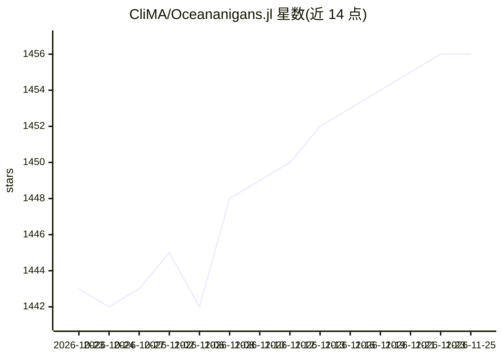

# CliMA/Oceananigans.jl

⭐ 1,456 · Julia · MIT · 推送 2026-11-23 · [GitHub](https://github.com/CliMA/Oceananigans.jl) · [官网](https://clima.github.io/OceananigansDocumentation/stable) · 组织维护

**海洋流体动力学 Julia 仿真库：CPU/GPU 求解 Boussinesq 方程**

Julia 语言编写的有限体积海洋流体仿真包，求解非静力与静力 Boussinesq 方程，支持笛卡尔与球壳域，可在 CPU 与 GPU 上运行。以注册 Julia 包形式分发，通过 Pkg.add 安装；改用 GPU() 架构即可在 Nvidia CUDA GPU 上运行同一仿真代码。由学界与业界贡献者社区驱动开发，测试基础设施由 atdepth 与 Climate Modeling Alliance 提供，附文档、示例、教程与持续性能基准面板。

## 筛选速览

| 维度 | 判定 | 备注 |
|---|---|---|
| AI 角色 | `ai-enhanced` | 去掉 AI 部分产品仍成立 |
| 许可风险 | `permissive` | MIT |
| 部署形态 | `None` |  |
| 模型依赖 | — | README 未给出锁定关系 |
| 硬件要求 | — | 无带数字的原话,不猜 |
| 安装摩擦 | `medium` | 含编译或系统依赖之一 |
| 成熟度 | — | 结构信号不足 |

## 能力要点

- 有限体积求解非静力/静力 Boussinesq 方程，支持笛卡尔与球壳域
- 同一仿真代码可将 CPU() 换为 GPU() 运行于 Nvidia CUDA GPU
- MIT 许可的注册 Julia 包，含文档、教程与性能基准面板
- 社区维护多篇开发论文，含 ML 增强的边界层参数化 NORi

## 适用场景

- 模拟海洋湍流、深对流等不可压缩流体动力学过程
- 在 GPU 上开展中尺度分辨率的全球海洋气候仿真
- 科研与教学中构建和运行数值海洋模型实验

## 场景标签

`科研工具` · 领域:学习与行业

## 证据(README 行号)

> L3:  🌊 Fast and friendly ocean-flavored Julia software for simulating incompressible fluid dynamics in Cartesian and sph
> L44: Oceananigans is a fast, friendly, flexible software package for finite volume simulations of the nonhydrostatic
> L86: But there's more: loading CUDA.jl (via `using CUDA`) and changing `CPU()` to `GPU()` makes this code run on a CUDA-

## 星数曲线

2026-10-23 1,443 → 2026-11-25 1,456（+13）

---
*卡片 v1 · prompt 1.4 · 生成 2026-11-23 · 置信度 high · 依据 README sha `c38f74e60a10` · [字段定义](../../DATASET.md)*
