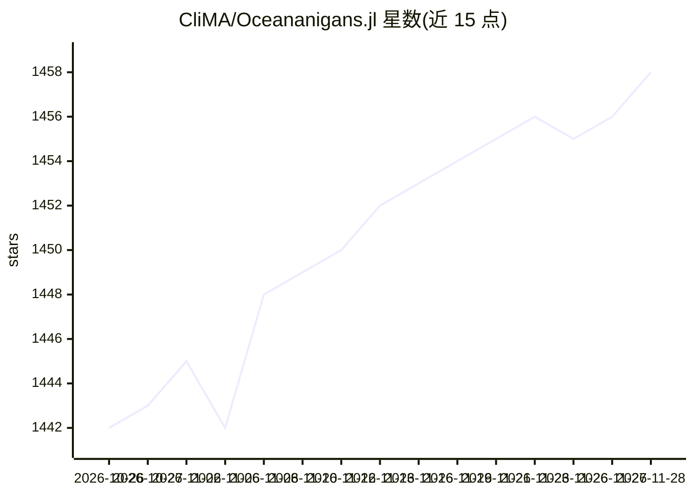

# CliMA/Oceananigans.jl

⭐ 1,458 · Julia · MIT · 推送 2026-11-27 · [GitHub](https://github.com/CliMA/Oceananigans.jl) · [官网](https://clima.github.io/OceananigansDocumentation/stable) · 组织维护

**海洋流体动力学 Julia 模拟库：在 CPU/GPU 上求解 Boussinesq 方程**

Oceananigans.jl 是注册于 Julia 生态的有限体积法求解器包，用于在笛卡尔与球壳域上模拟非静压/静压 Boussinesq 方程，支持 CPU 与 Nvidia GPU（通过 CUDA.jl 切换）。安装方式为 Julia Pkg（需 Julia 1.10+），提供稳定版与开发版文档、示例脚本与教程、性能基准看板，并由 Climate Modeling Alliance 提供测试基础设施。社区驱动开发，采用 MIT 许可，附多篇关联论文与引用条目，其中包含机器学习增强的海洋边界层参数化（NORi）等工作。

## 筛选速览

| 维度 | 判定 | 备注 |
|---|---|---|
| AI 角色 | `ai-enhanced` | 去掉 AI 部分产品仍成立 |
| 许可风险 | `permissive` | MIT |
| 部署形态 | `None` |  |
| 模型依赖 | — | README 未给出锁定关系 |
| 硬件要求 | — | 无带数字的原话,不猜 |
| 安装摩擦 | `medium` | 含编译或系统依赖之一 |
| 成熟度 | — | 结构信号不足 |

## 能力要点

- 有限体积法求解非静压/静压 Boussinesq 方程（NonhydrostaticModel/HydrostaticFreeSurfaceModel）
- 支持 CPU 与 CUDA Nvidia GPU，同一代码切换 CPU()/GPU() 即可
- 提供 WENO 等平流格式与自动校准的 CATKE 垂直扩散参数化
- 支持多 GPU Distributed 架构与可微分工作流（Enzyme.jl/Reactant.jl）

## 适用场景

- 海洋湍流与对流的大涡模拟实验
- 海洋边界层混合参数化的训练与校准
- 公里级分辨率全球海洋气候模拟
- GPU 上运行地球物理流体动力学教学示例

## 场景标签

 · 领域:科学计算/气候与海洋模拟

## 证据(README 行号)

> L44: Oceananigans is a fast, friendly, flexible software package for finite volume simulations of the nonhydrostatic
> L86: But there's more: loading CUDA.jl (via `using CUDA`) and changing `CPU()` to `GPU()` makes this code run on a CUDA-
> L146:  *This paper describes the development of NORi, a machine-learning-augmented parameterization for ocean boundary l

## 星数曲线

2026-10-26 1,442 → 2026-11-28 1,458（+16）

---
*卡片 v1 · prompt 1.4 · 生成 2026-11-28 · 置信度 high · 依据 README sha `3770de382694` · [字段定义](../../DATASET.md)*
