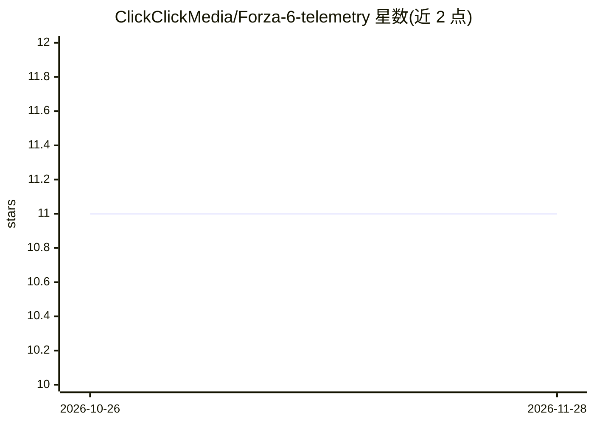

# ClickClickMedia/Forza-6-telemetry

⭐ 11 · Python · MIT · 推送 2026-07-28 · [GitHub](https://github.com/ClickClickMedia/Forza-6-telemetry) · 个人维护

**把手机变成 Forza Horizon 6 遥测仪表盘的本地工具**

自托管的 Forza Horizon 6 遥测工具：读取游戏内置 Data Out 的 UDP 广播，在手机 PWA 上显示实时仪表，记录每次行驶并拆分为圈速、实测功率曲线与逐弯证据，全部在本机计算。它本身不调车，而是将遥测、调校输入与跨会话差异打包成 zip（含 START-HERE.md 等），供上传到 Claude 或 ChatGPT 生成调校方案；也支持 Claude Desktop/Code 经 MCP 直接查询会话。Windows 提供单个 exe 免安装运行。

## 筛选速览

| 维度 | 判定 | 备注 |
|---|---|---|
| AI 角色 | `ai-enhanced` | 去掉 AI 部分产品仍成立 |
| 许可风险 | `permissive` | MIT |
| 部署形态 | `desktop` | 安装包/桌面程序 |
| 模型依赖 | — | README 未给出锁定关系 |
| 硬件要求 | — | 无带数字的原话,不猜 |
| 安装摩擦 | `low` | 无编译、无系统依赖或容器化 |
| 成熟度 | — | 结构信号不足 |

## 能力要点

- 手机 PWA 实时仪表盘，WebSocket 自动重连、胎温色块、漂移校正圈钟
- 从全油门帧重建实测功率曲线（dyno），标注可用功率带与低于带的油门占比
- 逐弯事件分类（发夹/弯道/蛇形绕桩等）与按弯相的转向不足/打滑指标
- 导出包含 raw-telemetry.csv（~60 Hz 全通道）、数据字典与来源标注，跨会话自动 diff

## 适用场景

- 在 Forza Horizon 6 中逐圈记录遥测并分析车辆平衡与动力输出
- 把导出的调校包交给 ChatGPT/Claude 生成调校方案
- 同一路线迭代调校时自动对比前后成绩差异

## 场景标签

 · 领域:游戏/模拟赛车工具

## 证据(README 行号)

> L12: This is a free, open-source, self-hosted tool. It listens to the telemetry
> L18: > **The tool never tunes your car and never invents a setting value.** It
> L85: Upload the `.zip` to Claude or ChatGPT with one line about your goal. You don't

## 星数曲线

2026-10-26 11 → 2026-11-28 11（+0）

---
*卡片 v1 · prompt 1.4 · 生成 2026-11-19 · 置信度 mid · 依据 README sha `0a10ae46bb00` · [字段定义](../../DATASET.md)*
