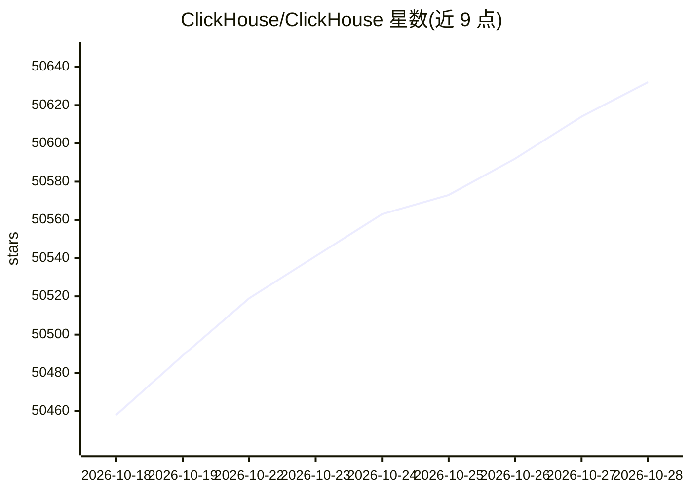

# ClickHouse/ClickHouse

⭐ 50,652 · C++ · Apache-2.0 · 推送 2026-10-28 · [GitHub](https://github.com/ClickHouse/ClickHouse) · [官网](https://clickhouse.com) · 组织维护

**面向开发者的实时分析型列式数据库管理系统**

开源列式数据库管理系统，用于实时生成分析数据报告。通过官方脚本一行命令安装于 Linux、macOS 和 FreeBSD，并提供 ClickHouse Cloud 托管服务作为免安装使用方式。README 同时维护月度发布与社区电话会议、全球线下 meetup、培训与招聘信息，公司由该数据库的创建者与维护者运营。核心定位为 OLAP 场景下的分析查询，主题标签覆盖分布式、云原生、lakehouse 等部署形态。

## 筛选速览

| 维度 | 判定 | 备注 |
|---|---|---|
| AI 角色 | `ai-ecosystem` | LLM/agent 周边工具 |
| 许可风险 | `permissive` | Apache-2.0 |
| 部署形态 | `None` |  |
| 模型依赖 | — | README 未给出锁定关系 |
| 硬件要求 | — | 无带数字的原话,不猜 |
| 安装摩擦 | `low` | 无编译、无系统依赖或容器化 |
| 成熟度 | — | 结构信号不足 |

## 动量与使用信号

- 维护:`active` — 距上次 push 0.6 天,年发版 100,313 位贡献者
- 涨星:近 1 天 **+13**(自 20261016 起算)
- 下载:GitHub Release 附件 累计 186,852(100 个 release)
- 平台:MACOS / LINUX · 协议:—

## 能力要点

- 列式存储的实时分析数据报告生成
- 一行 curl 脚本安装，支持 Linux/macOS/FreeBSD
- 提供托管服务 ClickHouse Cloud 免安装试用

## 适用场景

- 搭建实时数据分析报表与查询服务
- 需要分布式、云原生部署的分析型数据库选型
- 构建 lakehouse 场景下的查询引擎

## 场景标签

 · 领域:数据库/大数据分析

## 证据(README 行号)

> L6:  ClickHouse® is an open-source column-oriented database management system that allows generating analytical data rep
> L11: curl https://clickhouse.com/ | sh

## 星数曲线

2026-10-18 50,458 → 2026-10-28 50,632（+174）

---
*卡片 v1 · prompt 1.4 · 生成 2026-10-18 · 置信度 high · 依据 README sha `9b45adc34192` · [字段定义](../../DATASET.md)*
