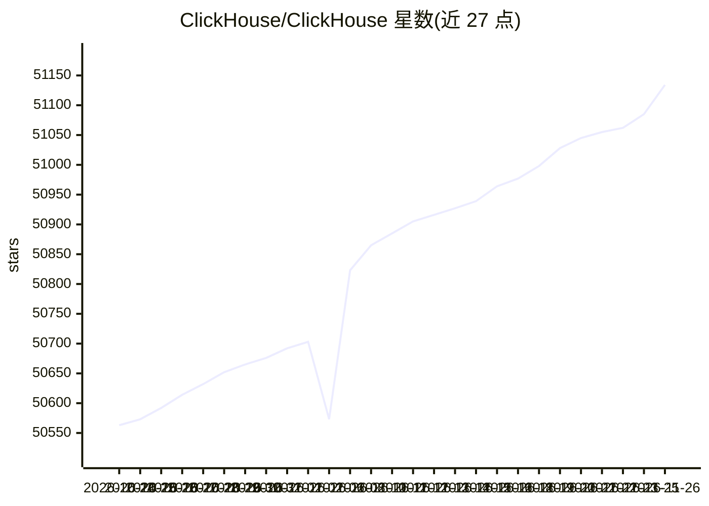

# ClickHouse/ClickHouse

⭐ 51,134 · C++ · Apache-2.0 · 推送 2026-11-25 · [GitHub](https://github.com/ClickHouse/ClickHouse) · [官网](https://clickhouse.com) · 组织维护

**实时列式分析型数据库管理系统**

ClickHouse 是一个开源的列式数据库管理系统，用于实时生成分析数据报告。提供 Linux、macOS、FreeBSD 下的脚本安装方式，另有托管的 ClickHouse Cloud 服务。README 主要介绍安装入口、官方文档/教程/社区渠道（Slack、Telegram、YouTube、博客），并包含月度发布电话会议、全球线下 meetup 活动列表、招聘信息等内容，属于项目主页型 README，具体功能特性需查阅其文档。

## 筛选速览

| 维度 | 判定 | 备注 |
|---|---|---|
| AI 角色 | `ai-enhanced` | 去掉 AI 部分产品仍成立 |
| 许可风险 | `permissive` | Apache-2.0 |
| 部署形态 | `None` |  |
| 模型依赖 | — | README 未给出锁定关系 |
| 硬件要求 | — | 无带数字的原话,不猜 |
| 安装摩擦 | `low` | 无编译、无系统依赖或容器化 |
| 成熟度 | — | 结构信号不足 |

## 动量与使用信号

- 维护:`active` — 距上次 push 0.6 天,年发版 100,313 位贡献者
- 涨星:近 1 天 **+13**(自 20261016 起算)
- 下载:GitHub Release 附件 累计 186,852(100 个 release)
- 平台:MACOS / LINUX · 协议:—

## 能力要点

- 列式存储的实时分析数据库管理系统
- 提供 Linux/macOS/FreeBSD 脚本安装方式
- 提供 ClickHouse Cloud 托管服务
- 月度发布电话会议与全球社区活动

## 适用场景

- 实时生成分析数据报表
- 需要自建分析型数据库的团队部署
- 通过 Cloud 服务快速开始查询数据

## 场景标签

 · 领域:数据库/大数据分析

## 证据(README 行号)

> L6:  ClickHouse® is an open-source column-oriented database management system that allows generating analytical data rep
> L8: ## How To Install (Linux, macOS, FreeBSD)

## 星数曲线

2026-10-24 50,563 → 2026-11-26 51,134（+571）

---
*卡片 v1 · prompt 1.4 · 生成 2026-11-22 · 置信度 high · 依据 README sha `d24eb11e32a2` · [字段定义](../../DATASET.md)*
