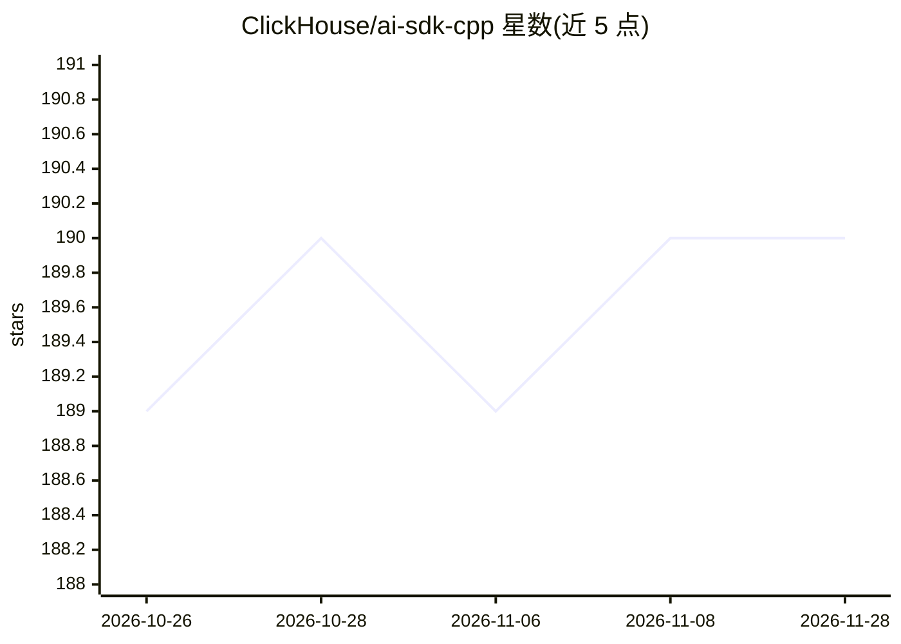

# ClickHouse/ai-sdk-cpp

⭐ 190 · C++ · Apache-2.0 · 推送 2026-11-27 · [GitHub](https://github.com/ClickHouse/ai-sdk-cpp) · 组织维护

**给 C++ 开发者的统一 AI 模型接入工具库**

由 ClickHouse 工程师维护的 C++20 库，通过统一 API 抽象 OpenAI、Anthropic、Google Gemini 与 Amazon Bedrock 等模型提供方的差异。核心模块覆盖文本生成、流式响应、多轮对话、工具调用（含多步与异步工具）、结构化输出、重试配置与嵌入（OpenAI）。Bedrock 支持为可选编译项，需启用 AWS SDK for C++。依赖精简，内置修补版 nlohmann/json 以消除 localeconv() 线程安全问题。安装需 C++20 编译器与 CMake 3.16+，从源码构建。

## 筛选速览

| 维度 | 判定 | 备注 |
|---|---|---|
| AI 角色 | `ai-ecosystem` | LLM/agent 周边工具 |
| 许可风险 | `permissive` | Apache-2.0 |
| 部署形态 | `None` |  |
| 模型依赖 | locked-api |  |
| 硬件要求 | — | 无带数字的原话,不猜 |
| 安装摩擦 | `medium` | 含编译或系统依赖之一 |
| 成熟度 | — | 结构信号不足 |

## 能力要点

- 统一 API 接入 OpenAI、Anthropic、Google Gemini、Amazon Bedrock
- 工具调用支持多步循环与异步并行执行
- 支持 OpenAI 兼容 API（自定义 base URL，如 OpenRouter）
- Bedrock 为可选编译项，经 Converse API 提供流式与工具调用

## 适用场景

- 在 C++ 应用中调用多家大模型服务
- 构建带工具调用的 AI Agent 工作流
- 通过 OpenRouter 等 OpenAI 兼容端点使用多模型

## 场景标签

 · 领域:LLM 基础设施/开发框架

## 证据(README 行号)

> L3: The AI SDK CPP is a modern C++ toolkit designed to help you build AI-powered applications with popular model provide
> L245: - ✅ **Text Generation**: Generate text completions with OpenAI, Anthropic, Bedrock, and Google Gemini models

## 星数曲线

2026-10-26 189 → 2026-11-28 190（+1）

---
*卡片 v1 · prompt 1.4 · 生成 2026-11-28 · 置信度 high · 依据 README sha `02e9165a16a5` · [字段定义](../../DATASET.md)*
