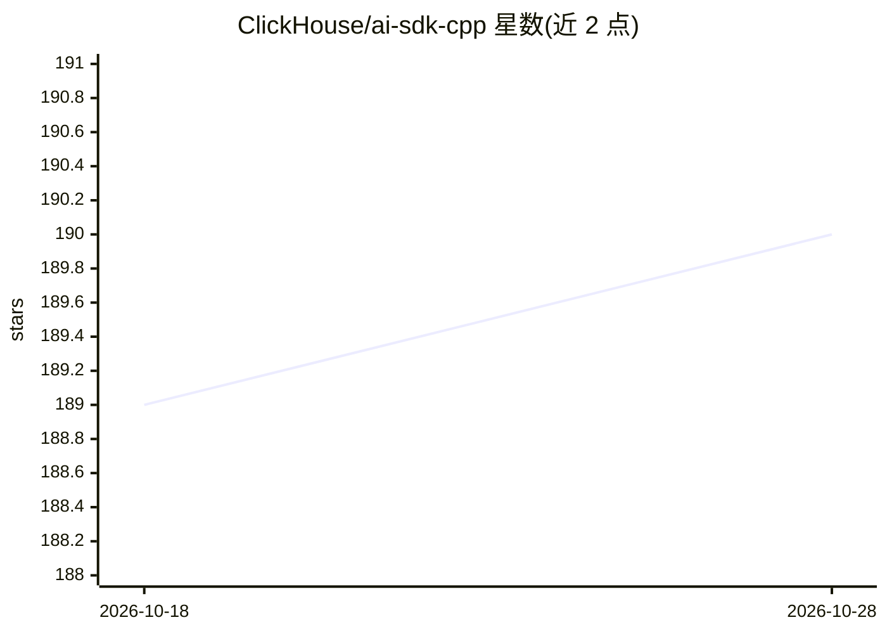

# ClickHouse/ai-sdk-cpp

⭐ 190 · C++ · Apache-2.0 · 推送 2026-08-19 · [GitHub](https://github.com/ClickHouse/ai-sdk-cpp) · 组织维护

**面向现代 C++ 的多模型统一 AI SDK 库**

ClickHouse 工程师维护的开源 C++20 库，为 C++ 开发者提供调用 OpenAI、Anthropic 等模型服务的统一 API，抽象不同 provider 的实现差异。支持文本生成、流式响应、多轮对话、函数调用（含异步工具）、可配置重试与 OpenAI 兼容 API（如 OpenRouter）。使用打补丁的 nlohmann/json 以去除非线程安全的 localeconv 调用。需 C++20 编译器与 CMake 3.16+，Google、Cohere 等 provider 与图像生成尚未实现。

## 筛选速览

| 维度 | 判定 | 备注 |
|---|---|---|
| AI 角色 | `ai-ecosystem` | LLM/agent 周边工具 |
| 许可风险 | `permissive` | Apache-2.0 |
| 部署形态 | `None` |  |
| 模型依赖 | — | README 未给出锁定关系 |
| 硬件要求 | — | 无带数字的原话,不猜 |
| 安装摩擦 | `medium` | 含编译或系统依赖之一 |
| 成熟度 | — | 结构信号不足 |

## 能力要点

- OpenAI 与 Anthropic 的统一 API 接入
- 函数调用与异步工具（并行处理）
- 可配置重试（指数退避）
- 支持任意 OpenAI 兼容 API（自定义 base URL，如 OpenRouter）

## 适用场景

- 在 C++20 项目中接入 OpenAI/Anthropic 模型
- 构建带工具调用的 AI agent 应用
- 通过 OpenRouter 等兼容端点切换模型供应商

## 场景标签

`模型网关` · 领域:Agent 开发

## 证据(README 行号)

> L3: The AI SDK CPP is a modern C++ toolkit designed to help you build AI-powered applications with popular model provide
> L9: - **Unified API**: Work with multiple AI providers through a single, consistent interface
> L21: The AI SDK CPP Core module provides a unified API to interact with model providers like OpenAI and Anthropic.

## 星数曲线

2026-10-18 189 → 2026-10-28 190（+1）

---
*卡片 v1 · prompt 1.4 · 生成 2026-10-22 · 置信度 high · 依据 README sha `7f2b170f4e9e` · [字段定义](../../DATASET.md)*
