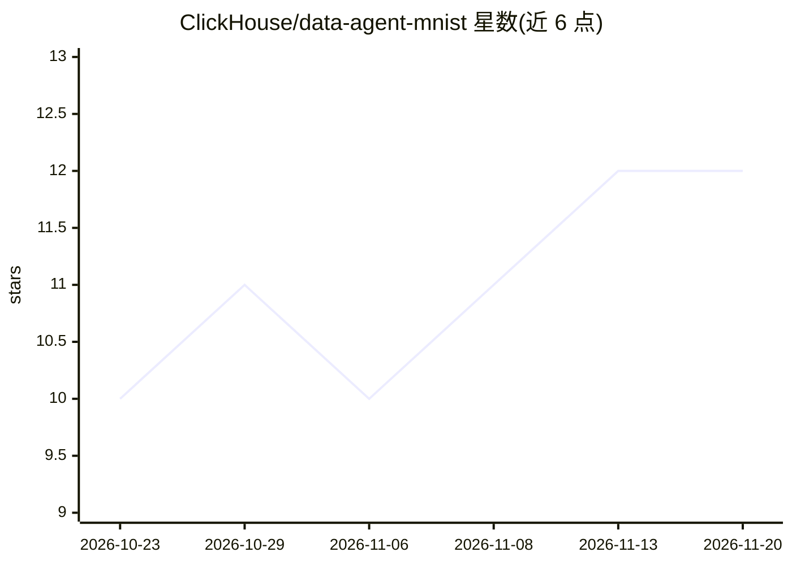

# ClickHouse/data-agent-mnist

⭐ 12 · Python · Apache-2.0 · 推送 2026-11-17 · [GitHub](https://github.com/ClickHouse/data-agent-mnist) · [官网](https://clickhouse.com/blog/agentic-analytics-benchmark-data-agent-mnist) · 组织维护

**用自有 ClickHouse 数仓构建分析型 agent 评测基准的工具集**

一套用于在用户自有数仓上构建 agentic analytics 基准的 harness：从提交的数据确定性播种可重放的仓库状态，让多个不同 provider 的模型独立求解每个问题，以「至少两个模型经独立路径一致」生成 ground truth，再由每 provider 一席的评委面板与确定性等价检查打分，输出带标准误与配对检验的榜单。仓库不含题目与数据，需 Python 3.13、uv 与三个 API key；步骤 2、3 调用模型会产生费用。

## 筛选速览

| 维度 | 判定 | 备注 |
|---|---|---|
| AI 角色 | `ai-ecosystem` | LLM/agent 周边工具 |
| 许可风险 | `permissive` | Apache-2.0 |
| 部署形态 | `None` |  |
| 模型依赖 | local-ok | 支持本地模型 |
| 硬件要求 | — | 无带数字的原话,不猜 |
| 安装摩擦 | `low` | 无编译、无系统依赖或容器化 |
| 成熟度 | — | 结构信号不足 |

## 能力要点

- 多 provider 独立求解达成一致即生成 ground truth，无需人工答案
- 评委面板每 provider 一席且候选模型不给自己打分
- verify_board.py 在花钱前校验仓库状态、引擎版本与时区可复现
- 候选经 OpenAI、Anthropic、Fireworks、AWS Bedrock、Vertex AI 或 OpenAI 兼容端点接入

## 适用场景

- 在自有 ClickHouse 数仓上比较哪个模型适合我们的 schema 与问题
- 对分析型 agent 做失败模式与 judge 偏差分析
- 构建可重放、可审计的内部模型评测榜单

## 场景标签

`模型评测` · 领域:评测与运维

## 证据(README 行号)

> L3: **Turn your own data warehouse into a benchmark for analytical agents.**
> L35: Four stages. You supply a warehouse and a set of questions; the harness supplies
> L193: A candidate is one entry in the model registry with a `provider`. The runners

## 星数曲线

2026-10-23 10 → 2026-11-20 12（+2）

---
*卡片 v1 · prompt 1.4 · 生成 2026-11-18 · 置信度 high · 依据 README sha `ff65217f7a5c` · [字段定义](../../DATASET.md)*
