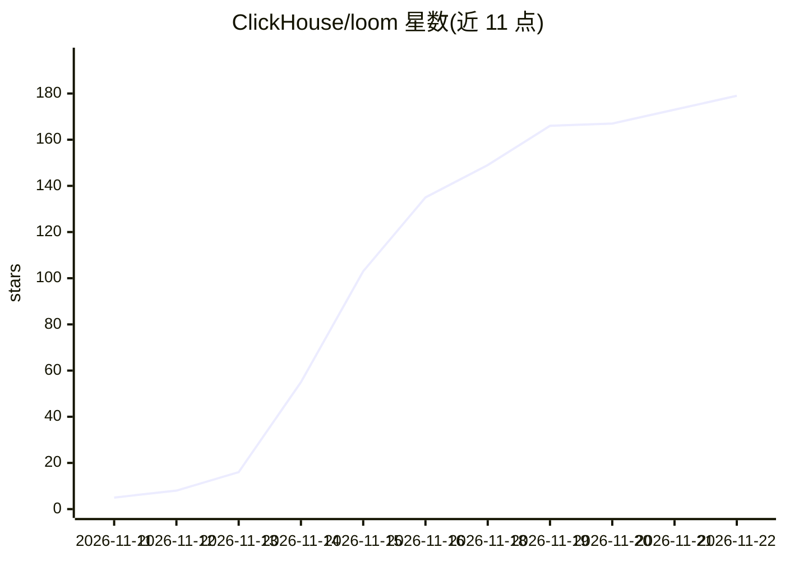

# ClickHouse/loom

⭐ 179 · Python · Apache-2.0 · 推送 2026-11-21 · [GitHub](https://github.com/ClickHouse/loom) · [官网](https://clickhouse.github.io/loom/) · 组织维护

**自托管 MCP 服务器：为 AI agent 提供共享长期记忆、文档搜索与代码索引**

ClickHouse 维护的开源自托管 MCP 服务器，面向编码 agent（Claude Code、Codex、Cursor）与自研 agent 应用，提供跨会话共享的长期记忆、带引用的文档检索（RAG，支持 PDF/docx/pptx）、可查询定义/调用方/变更影响的代码索引，以及记忆与代码文件和符号的绑定。数据存于 ClickHouse（可选 Postgres），通过 Docker 或 Kubernetes Helm 部署，提供 Python/TypeScript SDK 与多用户命名空间模式。默认安装无需 API key 即可运行（本地嵌入模型 + fake LLM）。README 声明它不是单 agent 短期记忆库，也不是 agent 框架。

## 筛选速览

| 维度 | 判定 | 备注 |
|---|---|---|
| AI 角色 | `ai-ecosystem` | LLM/agent 周边工具 |
| 许可风险 | `permissive` | Apache-2.0 |
| 部署形态 | `self-host` | docker 或自建部署 |
| 模型依赖 | — | README 未给出锁定关系 |
| 硬件要求 | — | 无带数字的原话,不猜 |
| 安装摩擦 | `low` | 无编译、无系统依赖或容器化 |
| 成熟度 | — | 结构信号不足 |

## 能力要点

- 跨 agent 共享长期记忆，记忆绑定代码文件/符号并随重构跟踪
- 代码索引支持定义、调用方、变更影响与相关测试查询
- 文档检索（RAG）带引用，支持 PDF/docx/pptx 转换
- MCP 服务器 + Claude Code/Codex 插件 + Python/TypeScript SDK

## 适用场景

- 让多个编码 agent 跨会话共享决策与发现
- 为 agent 应用接入多用户记忆服务（命名空间、角色、令牌）
- agent 通过代码索引定位定义、调用方与变更影响
- 对 agent 数据做审计、保留与可验证擦除

## 场景标签

`Agent 记忆` `RAG` · 领域:Agent 开发

## 证据(README 行号)

> L26: Loom is an open-source, self-hosted MCP server that gives your agents long-term, shared
> L29: Agents connect through MCP, HTTP, Python or TypeScript. Self-host with Docker or

## 星数曲线

2026-11-11 5 → 2026-11-22 179（+174）

---
*卡片 v1 · prompt 1.4 · 生成 2026-11-17 · 置信度 mid · 依据 README sha `e55a052ef0b3` · [字段定义](../../DATASET.md)*
