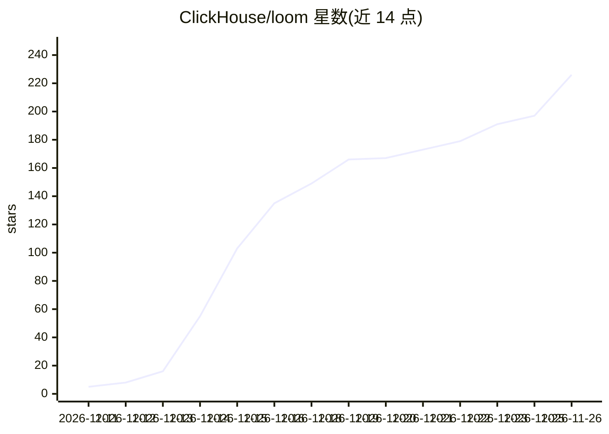

# ClickHouse/loom

⭐ 226 · Python · Apache-2.0 · 推送 2026-11-25 · [GitHub](https://github.com/ClickHouse/loom) · [官网](https://loom.clickhouse.com/docs) · 组织维护 · 中文 README

**给 AI 编码 agent 提供共享长期记忆、文档检索与代码索引的 MCP 服务器**

开源、可自托管的 MCP 服务器，为多个 agent 提供跨会话共享的长期记忆：记忆与代码文件、符号关联，在 agent 读取或编辑相关代码时浮现，并随重构迁移、变更时标记冲突。另提供带引用的文档检索（支持 PDF/DOCX/PPTX）和可查询定义、调用者、变更影响的代码索引。通过 MCP、HTTP、Python/TypeScript SDK 接入，提供 Claude Code、Codex 插件与 Cursor/VS Code 集成，数据存于 ClickHouse，Docker 或 Helm 部署，支持命名空间、角色与令牌的多用户模式。

## 筛选速览

| 维度 | 判定 | 备注 |
|---|---|---|
| AI 角色 | `ai-ecosystem` | LLM/agent 周边工具 |
| 许可风险 | `permissive` | Apache-2.0 |
| 部署形态 | `self-host` | docker 或自建部署 |
| 模型依赖 | — | README 未给出锁定关系 |
| 硬件要求 | — | 无带数字的原话,不猜 |
| 安装摩擦 | `low` | 无编译、无系统依赖或容器化 |
| 成熟度 | — | 结构信号不足 |

## 能力要点

- 记忆与代码位置关联，随重构追踪并在编辑时浮现
- 带引用的文档检索（RAG），支持 PDF/DOCX/PPTX
- 代码索引可查定义、调用者与变更影响
- 多用户模式：命名空间、读写角色与令牌隔离

## 适用场景

- 让多个编码 agent 跨会话共享经验教训与项目上下文
- 团队部署带权限隔离的多用户 MCP 记忆服务
- 为 agent 应用提供按用户隔离的记忆 SDK
- 检索内部文档并获得带出处的答案

## 场景标签

`Agent 记忆` `RAG` `语义搜索` · 领域:Agent 开发

## 证据(README 行号)

> L26: Loom is an open-source, self-hosted MCP server that gives your agents long-term, shared
> L31: Agents connect through MCP, HTTP, Python or TypeScript. Self-host with Docker or

## 星数曲线

2026-11-11 5 → 2026-11-26 226（+221）

---
*卡片 v1 · prompt 1.4 · 生成 2026-11-26 · 置信度 high · 依据 README sha `d881c1f69cd0` · [字段定义](../../DATASET.md)*
